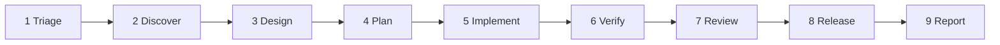

<div align="center">

# Workflow Master: AI Engineering Operating System

**Production-Ready Software Engineering Operating System & AI Standards**

[`ai-agents`](https://github.com/topics/ai-agents) • [`agent-skills`](https://github.com/topics/agent-skills) • [`ai-coding-assistant`](https://github.com/topics/ai-coding-assistant) • [`software-engineering`](https://github.com/topics/software-engineering) • [`best-practices`](https://github.com/topics/best-practices) • [`code-quality`](https://github.com/topics/code-quality) • [`owasp`](https://github.com/topics/owasp) • [`conventional-commits`](https://github.com/topics/conventional-commits) • [`cursor-rules`](https://github.com/topics/cursor-rules) • [`prompt-engineering`](https://github.com/topics/prompt-engineering)

[](./LICENSE)
[](#)
[](#)
[](#)

*Engineering standards (Frontend, Backend, Database, QA, Security, Architecture, DevOps, SRE, Performance, Docs, Git), executable agent skills, and structured workflows that let AI coding assistants move fast without compromising security, data integrity, or architecture.*

</div>

---

## Pratinjau Sistem & Disiplin Rekayasa

<p align="center">
  
</p>

---

## Why Workflow Master Is Essential

Modern AI models generate code at unprecedented speed. Without explicit boundaries, AI agents frequently:
1. Introduce unnecessary abstractions and overengineering.
2. Rely on frontend assumptions and neglect server-side validation.
3. Write brittle tests or claim tests pass without running them.
4. Hardcode secrets, leak credentials, or corrupt live database schemas.

Workflow Master combines three layers:

| Layer | Role | Location |
|---|---|---|
| **Rules** | What is mandatory (standards, constraints, anti-patterns) | [`rules/`](./rules) |
| **Skills** | How to execute it (step-by-step procedures plus runnable scripts) | [`skills/`](./skills) |
| **Workflows** | When to apply it (9-stage lifecycle and orchestration prompts) | [`workflows/`](./workflows) |

---

## Agent Skills

Eleven skills in the universal `SKILL.md` format, compatible with Antigravity, Claude Code, and any agent that loads skill folders. Full catalog: [`skills/README.md`](./skills/README.md).

| Skill | Stage | Script | Purpose |
|---|---|---|---|
| [`domain-scaffolding`](./skills/domain-scaffolding/SKILL.md) | Design, Plan | - | Rule 16 dual-sided apps with seed data and demo accounts |
| [`laravel-web-studio`](./skills/laravel-web-studio/SKILL.md) | Design, Implement | yes | End-to-end Laravel + Tailwind studio for SME websites |
| [`shadcn-admin-design-system`](./skills/shadcn-admin-design-system/SKILL.md) | Implement | - | Slate oklch design system, dashboard and admin patterns |
| [`clean-code-concise-docs`](./skills/clean-code-concise-docs/SKILL.md) | Implement | - | Concise code, clean logs, emoji-free docs, formal language |
| [`verify-and-test`](./skills/verify-and-test/SKILL.md) | Verify | `verify.ps1` | Stack detection, typecheck/lint/test/build with real evidence |
| [`diff-review`](./skills/diff-review/SKILL.md) | Review | `scan-diff.ps1` | Secret, PII, debug leftover and demo credential scanner |
| [`security-audit`](./skills/security-audit/SKILL.md) | Review | - | Four-phase OWASP audit with stack checklists and report template |
| [`git-commit-craft`](./skills/git-commit-craft/SKILL.md) | Review | - | Conventional Commits with mandatory co-author trailer |
| [`github-repo-publish`](./skills/github-repo-publish/SKILL.md) | Release | `publish-repo.ps1` | Repo creation, collaborator invite, topic sync |
| [`release-deploy-check`](./skills/release-deploy-check/SKILL.md) | Release | `check-deploy.ps1` | Watch GitHub Actions and probe the live URL and assets |
| [`readme-github-sync`](./skills/readme-github-sync/SKILL.md) | Report | `check-readme.ps1`, `sync-topics.ps1` | README validator, GitHub-safe math, topic sync |

### Install

```powershell
git clone https://github.com/pranataa-labs/workflow-master.git
cd workflow-master

# Antigravity / Gemini (global)
powershell -ExecutionPolicy Bypass -File skills/install-skills.ps1 -Target "$HOME\.gemini\config\skills"

# Claude Code (global)
powershell -ExecutionPolicy Bypass -File skills/install-skills.ps1 -Target "$HOME\.claude\skills"
```

---

## Repository Architecture

```text
workflow-master/
├── AGENTS.md                      # Ready-to-copy universal AI directives
├── .cursorrules                   # Ready-to-copy root Cursor configuration
├── README.md
│
├── workflows/                     # 9-stage lifecycle and orchestration prompts
│   ├── 00-engineering-workflow-ai-coding.md
│   └── 01-master-prompt-and-workflow-fullstack.md
│
├── rules/                         # 20 modular rule packages
│   ├── 01-frontend ... 10-performance
│   ├── 11-documentation-api-contract-rules.md
│   ├── 12-git-ai-change-management-rules.md
│   ├── 13-ai-agent ... 15-data-engineering
│   ├── 16-autonomous-domain-archetypes-scaffolding.md
│   ├── 17-machine-learning-mlops-engineering-rules.md
│   ├── 18-agent-operational-discipline-anti-patterns.md
│   ├── 19-anti-slop-humanized-ui-design-rules.md
│   └── 20-concise-code-clean-logs-and-docs-rules.md
│
├── skills/                        # Executable agent skills (SKILL.md + scripts)
│   ├── README.md                  # Skill catalog and stage mapping
│   ├── install-skills.ps1         # Installer for Antigravity / Claude Code
│   ├── clean-code-concise-docs/
│   ├── diff-review/               # scripts/scan-diff.ps1
│   ├── domain-scaffolding/        # resources/blueprint-template.md
│   ├── git-commit-craft/
│   ├── github-repo-publish/       # scripts/publish-repo.ps1
│   ├── laravel-web-studio/        # references/, resources/, scripts/
│   ├── readme-github-sync/        # scripts/check-readme.ps1, sync-topics.ps1
│   ├── release-deploy-check/      # scripts/check-deploy.ps1
│   ├── security-audit/            # resources/audit-report-template.md
│   ├── shadcn-admin-design-system/
│   └── verify-and-test/           # scripts/verify.ps1
│
├── bundles/                       # Single-file rule bundles for chat-based assistants
└── templates/                     # AGENTS.md, Cursor .mdc, Claude, Copilot, Windsurf, git hooks
```

---

## The 9-Stage Engineering Discipline



1. **Triage:** Define scope, classify the task, and assign risk (Low, Medium, High).
2. **Discover:** Read contracts, configuration, and dependencies before modifying code.
3. **Design:** Set acceptance criteria, edge cases, and rollback plans. Skill: `domain-scaffolding`.
4. **Plan:** Sequence minimal, modular, non-breaking changes.
5. **Implement:** Write clean, type-safe code following project conventions. Skills: `clean-code-concise-docs`, `shadcn-admin-design-system`, `laravel-web-studio`.
6. **Verify:** Run tests, linters, and typecheckers; report real output. Skill: `verify-and-test`.
7. **Review:** Inspect diffs, block secrets, enforce authorization. Skills: `diff-review`, `security-audit`, `git-commit-craft`.
8. **Release:** Confirm the pipeline and live health checks. Skills: `github-repo-publish`, `release-deploy-check`.
9. **Report:** Deliver factual summaries and documentation. Skill: `readme-github-sync`.

---

## Security Baseline & Admin Route Obfuscation

- **Admin Route Obfuscation:** Administrative routes (`/admin`) are never statically exposed in production. The prefix comes from an environment variable (e.g. `ADMIN_PREFIX`) and default paths return **HTTP 404**.
- **Strict Role-Based Access Control:** Authorization is enforced on the server, with clear feedback on permission denial.
- **Input Boundaries:** Parameter binding, anti-CSRF tokens, and HTML sanitization on every input stream.
- **Automated Guardrails:** `diff-review` blocks hardcoded secrets and `.env` files before commit; `security-audit` runs the four-phase OWASP protocol before release.

---

## License & Attribution

Distributed under the [MIT License](./LICENSE). Designed and curated by **[pranataa-labs](https://github.com/pranataa-labs)**.
