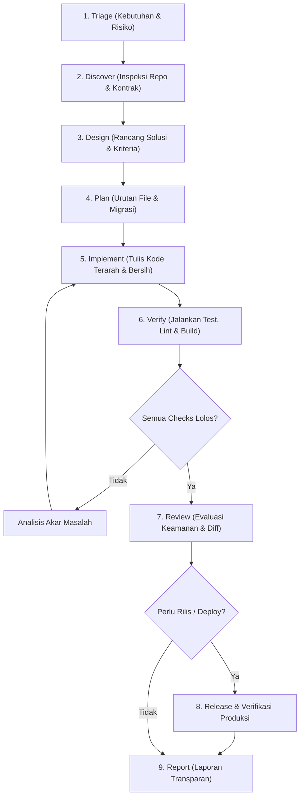

<div align="center">

# ⚡ Workflow Master: AI Engineering Operating System

**Sistem Standar Rekayasa Perangkat Lunak & Alur Kerja AI Siap Produksi (Production-Ready)**

[](./LICENSE)
[](#)
[](#)
[](#)

*Kumpulan standar rekayasa komprehensif (Frontend, Backend, Database, QA, Security, Architecture, DevOps, SRE, Performance, Docs, Git) dan alur kerja terstruktur untuk memaksimalkan kapabilitas AI Coding Assistants tanpa mengorbankan keamanan, integritas data, dan arsitektur.*

---

</div>

## 📌 Mengapa Workflow Master Dibutuhkan?

Model AI modern (seperti Claude 3.7 Sonnet, Gemini 2.5 Flash/Pro, GPT-4o) sangat cepat menghasilkan kode, tetapi tanpa batasan arsitektur yang ketat, AI sering kali:
1. Melakukan *overengineering* atau menambahkan abstraksi yang tidak perlu.
2. Mengabaikan validasi server dan mengasumsikan input frontend aman.
3. Menulis pengujian otomatis yang rapuh, flaky, atau mengklaim tes lulus tanpa menjalankannya.
4. Melakukan *hardcoding* rahasia / API keys atau merusak skema database yang sudah berjalan.

**Workflow Master** hadir sebagai sistem kendali (*guardrails & operational framework*) yang mengubah AI dari sekadar generator kode acak menjadi **Principal / Staff Software Engineer** yang berdisiplin tinggi, aman secara arsitektur, dan mematuhi standar industri global.

---

## 🏗️ Struktur Repository

```text
workflow-master/
├── .gitignore
├── LICENSE
├── CONTRIBUTING.md
├── README.md                                         # Hub dokumentasi utama
│
├── workflows/                                        # Alur kerja & master prompt orkestrator
│   ├── README.md                                     # Panduan siklus hidup AI
│   ├── 00-engineering-workflow-ai-coding.md          # 9 tahapan lifecycle & risk matrix
│   └── 01-master-prompt-and-workflow-fullstack.md    # Master prompt Full-Stack orchestrator
│
├── rules/                                            # 12 Paket Aturan Modular (Production-Ready)
│   ├── README.md                                     # Katalog & panduan seleksi aturan
│   ├── 01-frontend-engineering-rules.md              # UI/UX, Component, a11y (WCAG 2.2 AA), Web Vitals
│   ├── 02-backend-engineering-rules.md               # Clean architecture, RESTful API, Auth, Boundary
│   ├── 03-database-engineering-rules.md              # MySQL 8+ / InnoDB, 3NF, Indexing, Concurrency
│   ├── 04-testing-qa-rules.md                        # SDET, AAA pattern, Test isolation, Strict assertions
│   ├── 05-security-engineering-rules.md              # OWASP ASVS/Top 10, Threat modeling, Secrets
│   ├── 06-code-quality-review-rules.md               # SOLID, DRY, KISS, Naming, PR review hygiene
│   ├── 07-system-architecture-design-rules.md        # C4 model, Modular monolith, Loose coupling, ADR
│   ├── 08-devops-ci-cd-deployment-rules.md           # 12-Factor App, CI/CD, Zero-downtime, Migrations
│   ├── 09-reliability-observability-incident-rules.md# OpenTelemetry, SLO/SLA, Tracing, Incident runbooks
│   ├── 10-performance-scalability-rules.md           # Performance budgets, Profiling, Caching, Scaling
│   ├── 11-documentation-api-contract-rules.md        # OpenAPI/Swagger, Versioning, Docs hygiene
│   └── 12-git-ai-change-management-rules.md          # Conventional commits, Atomic diffs, Truthful reports
│
├── bundles/                                          # All-in-One Prompts (Untuk ChatGPT/Claude Web UI)
│   ├── README.md                                     # Petunjuk penggunaan single prompt
│   ├── master-engineering-fullstack-bundle.md        # Monolithic prompt FE + BE + DB + QA (~83 KB)
│   ├── master-engineering-backend-database-bundle.md # Monolithic prompt BE + Database (~37 KB)
│   └── engineering-rules-pack-bundle.md              # Monolithic prompt Rules 05 s/d 12 (~57 KB)
│
└── templates/                                        # Preset konfigurasi siap pakai untuk berbagai IDE
    ├── README.md                                     # Petunjuk instalasi template
    ├── .cursorrules                                  # Aturan bawaan untuk Cursor IDE
    ├── claude-code-prompt.md                         # System prompt untuk Claude Code / CLAUDE.md
    ├── windsurf-rules.md                             # Aturan untuk Windsurf (Codeium Cascade)
    └── copilot-instructions.md                       # Aturan untuk GitHub Copilot (.github/)
```

---

## 🔄 9 Tahap Alur Kerja Rekayasa AI (The 9-Stage Lifecycle)

Setiap interaksi rekayasa kode dengan AI mengikuti alur kerja terstruktur dari permintaan hingga verifikasi dan pelaporan:



### Risk-Based Governance:
- 🟢 **Low Risk (Copy, styling kecil, format teks):** Inspeksi lokal &rarr; implementasi minimal &rarr; review diff.
- 🟡 **Medium Risk (Endpoint baru, komponen interaktif, domain logic terisolasi):** Acceptance criteria spesifik &rarr; unit/integration test happy & unhappy path &rarr; linter/typecheck.
- 🔴 **High Risk (Auth, migrasi database, payment, PII, perubahan arsitektur):** Threat modeling &rarr; rencana kompatibilitas migrasi & rollback &rarr; verifikasi ketat.

---

## 📚 Katalog 12 Aturan Rekayasa (The 12 Rules Suite)

| # | Aturan | Deskripsi & Ruang Lingkup |
|:---:|---|---|
| **01** | [**Frontend Engineering**](./rules/01-frontend-engineering-rules.md) | Arsitektur komponen, desain responsif *mobile-first*, manajemen state, aksesibilitas W3C WCAG 2.2 AA, dan optimasi Core Web Vitals (LCP, INP, CLS). |
| **02** | [**Backend Engineering**](./rules/02-backend-engineering-rules.md) | Clean architecture, modular monolith, kontrak API REST/JSON yang konsisten, autentikasi, otorisasi least-privilege, dan batas transaksional. |
| **03** | [**Database Architecture**](./rules/03-database-engineering-rules.md) | Pemodelan relasional (3NF), InnoDB/MySQL 8+, PostgreSQL, indexing strategies, foreign key constraints, transaksi ACID, dan migrasi tanpa downtime. |
| **04** | [**QA & Automated Testing**](./rules/04-testing-qa-rules.md) | Pola AAA (*Arrange-Act-Assert*), isolasi database per test, mocking external network calls, asersi ketat, fixtures/factories, dan truthful reporting. |
| **05** | [**Security Engineering**](./rules/05-security-engineering-rules.md) | Security-by-design, defense-in-depth, threat modeling STRIDE, proteksi OWASP Top 10, sanitasi input server-side, dan manajemen rahasia/secrets. |
| **06** | [**Code Quality & Review**](./rules/06-code-quality-review-rules.md) | Prinsip SOLID, KISS, DRY, YAGNI, konvensi penamaan bermakna, error handling terstruktur, dan etika refactoring tanpa mengubah perilaku bisnis. |
| **07** | [**System Architecture**](./rules/07-system-architecture-design-rules.md) | Batas sistem (*system boundaries*), loose coupling, C4 model architecture, dokumentasi keputusan menggunakan ADR (*Architecture Decision Records*). |
| **08** | [**DevOps & CI/CD**](./rules/08-devops-ci-cd-deployment-rules.md) | Otomasi pipeline CI/CD, kepatuhan 12-Factor App, containerization Docker, strategi rilis (canary/blue-green), dan migrasi skema terkendali. |
| **09** | [**Reliability & SRE**](./rules/09-reliability-observability-incident-rules.md) | Telemetri OpenTelemetry (Logs, Metrics, Traces), penetapan SLO/SLA, graceful degradation, circuit breaker, dan manajemen pemulihan insiden. |
| **10** | [**Performance & Scale**](./rules/10-performance-scalability-rules.md) | Penetapan *performance budget*, profiling botol leher, strategi multi-tier caching (Redis/Memory), optimasi query, dan kesiapan skalabilitas horizontal. |
| **11** | [**Documentation & API**](./rules/11-documentation-api-contract-rules.md) | Standarisasi OpenAPI 3.0/Swagger, semantik versioning (SemVer), runbook operasional, dan dokumentasi onboarding teknis yang jelas. |
| **12** | [**Git & AI Change Ops**](./rules/12-git-ai-change-management-rules.md) | Conventional Commits, diff terarah atomik, pencegahan kerusakan codebase, serta kewajiban pelaporan verifikasi nyata (*truthful reporting*). |

---

## 🎯 Cara Memilih Aturan Sesuai Kebutuhan

Tidak perlu memuat seluruh dokumen ke dalam satu prompt. Gunakan panduan seleksi berikut:

| Jenis Tugas | Aturan Utama yang Wajib Diterapkan |
|---|---|
| **UI, Styling, Interaksi Web** | `01 Frontend` + `04 Testing` + `06 Quality` |
| **API Endpoint, Business Logic, Auth** | `02 Backend` + `05 Security` + `04 Testing` + `11 Docs` |
| **Skema Database, Query, Migrasi** | `03 Database` + `02 Backend` + `05 Security` + `08 DevOps` |
| **Refactoring & Code Review** | `06 Quality` + `12 Git/AI` + `04 Testing` + `07 Architecture` |
| **Arsitektur Baru / Modul Baru** | `07 Architecture` + `02 Backend` + `03 Database` + `05 Security` |
| **Pipeline Build, Docker, Deploy** | `08 DevOps` + `09 SRE` + `12 Git/AI` + `05 Security` |
| **Optimasi Kecepatan & Kapasitas** | `10 Performance` + `03 Database` + `09 SRE` + `01 Frontend` |

---

## 🚀 Integrasi Cepat dengan AI Tools & IDE

### 1. Cursor IDE
Salin file [`templates/.cursorrules`](./templates/.cursorrules) ke root direktori proyek Anda:
```bash
cp templates/.cursorrules /path/to/your/project/.cursorrules
```

### 2. Claude Code / CLAUDE.md
Gunakan template [`templates/claude-code-prompt.md`](./templates/claude-code-prompt.md) sebagai panduan `CLAUDE.md` di root proyek Anda.

### 3. Windsurf (Codeium Cascade)
Salin template [`templates/windsurf-rules.md`](./templates/windsurf-rules.md) ke `.windsurfrules` pada proyek Anda.

### 4. GitHub Copilot
Salin [`templates/copilot-instructions.md`](./templates/copilot-instructions.md) ke `.github/copilot-instructions.md`.

---

## 🌐 Standar Acuan Industri

Dokumen di dalam repository ini dibangun dengan merujuk pada standar industri terpercaya:
- **Security:** [OWASP ASVS 4.0](https://asvs.owasp.org/) & [OWASP Top 10](https://owasp.org/www-project-top-ten/)
- **Software Supply Chain:** [NIST SSDF (SP 800-218)](https://csrc.nist.gov/Projects/ssdf)
- **Architecture Modeling:** [C4 Model by Simon Brown](https://c4model.com/)
- **Architecture Decisions:** [Architecture Decision Records (ADR)](https://adr.github.io/)
- **Observability & SRE:** [OpenTelemetry](https://opentelemetry.io/) & [Google SRE Framework](https://sre.google/sre-book/)
- **API Standards:** [OpenAPI 3.1 Specification](https://spec.openapis.org/oas/latest.html)
- **Frontend & a11y:** [W3C WCAG 2.2](https://www.w3.org/WAI/standards-guidelines/wcag/) & [Google Web Vitals](https://web.dev/articles/vitals)

---

## 📄 Lisensi & Kontributor

Dikelola oleh **[Muhammad Aria Sastra (pranataa-labs)](https://github.com/pranataa-labs)**.  
Didistribusikan di bawah lisensi terbuka [MIT License](./LICENSE). Silakan gunakan, adaptasi, dan terapkan pada proyek pribadi maupun tim perusahaan Anda.
