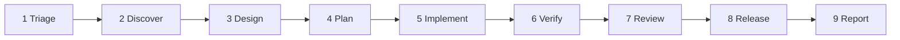

<div align="center">

# Workflow Master: AI Engineering Operating System

**Production-Ready Software Engineering Operating System, Executable Agent Skills & AI Standards**

[`ai-agents`](https://github.com/topics/ai-agents) • [`agent-skills`](https://github.com/topics/agent-skills) • [`ai-coding-assistant`](https://github.com/topics/ai-coding-assistant) • [`software-engineering`](https://github.com/topics/software-engineering) • [`machine-learning`](https://github.com/topics/machine-learning) • [`data-science`](https://github.com/topics/data-science) • [`design-system`](https://github.com/topics/design-system) • [`owasp`](https://github.com/topics/owasp) • [`conventional-commits`](https://github.com/topics/conventional-commits) • [`cursor-rules`](https://github.com/topics/cursor-rules)

[](./LICENSE)
[](#)
[](#)
[](#)

*A complete governance framework of 20 engineering rules, 16 executable agent skills, and structured 9-stage workflows across Frontend/UI, Backend, Database, QA, Security, Data Analysis, Data Science, Machine Learning, and Executive Reporting.*

</div>

---

## Pratinjau Sistem & Disiplin Rekayasa

<p align="center">
  
</p>

---

## Why Workflow Master Is Essential

Modern AI models generate code rapidly, but without explicit architectural and statistical guardrails they routinely:
1. Ship generic, cookie-cutter interfaces (identical font stacks, purple gradients, and 4-card KPI rows across every project).
2. Pollute code comments, terminal logs, and documentation with emojis, informal slang, and AI rhetoric cliches.
3. Introduce data leakage in Machine Learning pipelines (e.g. fitting preprocessors on test sets or skipping baseline models).
4. Claim tests pass without executing them, or leak credentials into Git history.

Workflow Master solves this by combining three layers:

| Layer | Role | Location |
|---|---|---|
| **Rules (20)** | What is mandatory (standards, constraints, anti-patterns) | [`rules/`](./rules) |
| **Skills (16)** | How to execute it (step-by-step procedures plus runnable CLI scripts) | [`skills/`](./skills) |
| **Workflows (2)** | When to apply it (9-stage lifecycle and orchestration prompts) | [`workflows/`](./workflows) |

---

## Executable Agent Skills (16 Skills)

All skills follow the universal `SKILL.md` standard and include zero-dependency PowerShell or Python verification/automation scripts. Full catalog: [`skills/README.md`](./skills/README.md).

### UI/UX Design, Full-Stack & Code Hygiene
| Skill | Stage | Script / Tool | Purpose |
|---|---|---|---|
| [`distinctive-ui-design`](./skills/distinctive-ui-design/SKILL.md) | Design, Implement | `ui-sloplint.ps1` | 4 Surface Modes, 8 Domain Visual Archetypes (OKLCH + font pairs), 15-point Craft Floor, Honest Data-Viz |
| [`shadcn-admin-design-system`](./skills/shadcn-admin-design-system/SKILL.md) | Implement | `theme.css`, `patterns.md` | Mode Operate backoffice system with 4 distinct dashboard compositions and `tabular-nums` |
| [`domain-scaffolding`](./skills/domain-scaffolding/SKILL.md) | Design, Plan | `blueprint-template.md` | Rule 16 dual-sided apps (Customer + obfuscated Admin), 6-12 realistic seed items, clean handoff |
| [`laravel-web-studio`](./skills/laravel-web-studio/SKILL.md) | Design, Implement | `new-project.ps1`, `perf-check.ps1` | End-to-end Laravel + Blade + Tailwind studio for SME and enterprise web apps |
| [`clean-code-concise-docs`](./skills/clean-code-concise-docs/SKILL.md) | Implement, Review | `check-code-hygiene.ps1` | Enforces emoji-free comments/logs/headings, formal KBBI vocabulary, and de-AI-ified prose |

### Data Analysis, Data Science, Machine Learning & Reporting
| Skill | Stage | Script / Tool | Purpose |
|---|---|---|---|
| [`data-analysis-explorer`](./skills/data-analysis-explorer/SKILL.md) | Discover, Implement | `profile-dataset.py` | Full-dataset profiling, parametric + robust stats (Median/IQR/skewness), IQR anomalies, Pearson/Spearman correlations |
| [`data-science-workbench`](./skills/data-science-workbench/SKILL.md) | Design, Verify | `stat-test.py` | Sample size / power calculator, SRM check, Welch's t-test, Z-test, Cohen's d/h, multiple testing & DiD causal inference |
| [`ml-model-engineering`](./skills/ml-model-engineering/SKILL.md) | Implement, Verify | `train-evaluate-baseline.py` | Leakage-free `ColumnTransformer` + `Pipeline`, 3-tier ladder (Dummy -> Linear -> GBDT), overfitting gap, slice error analysis, `model_manifest.json` |
| [`professional-report-writer`](./skills/professional-report-writer/SKILL.md) | Report | `build-html-report.py` | Minto Pyramid (BLUF) reports, `tabular-nums` tables, KaTeX math, single-file print-ready A4 HTML/PDF generator |

### QA, Security, Git & Release Governance
| Skill | Stage | Script / Tool | Purpose |
|---|---|---|---|
| [`verify-and-test`](./skills/verify-and-test/SKILL.md) | Verify | `verify.ps1` | Stack detection (Node/TS, Python, PHP/Laravel, Go) and truthful typecheck/lint/test/build runner |
| [`diff-review`](./skills/diff-review/SKILL.md) | Review | `scan-diff.ps1` | Pre-commit scanner for secrets, API keys, `.env`, PII, debug leftovers, and pre-filled demo credentials |
| [`security-audit`](./skills/security-audit/SKILL.md) | Review | `audit-report-template.md` | Four-phase OWASP Top 10 audit (Recon, Hunting, Proof Validation, Structured Patching) |
| [`git-commit-craft`](./skills/git-commit-craft/SKILL.md) | Review | `setup-git-discipline.ps1` | Conventional Commits with mandatory Rule 12.1 co-author trailer |
| [`github-repo-publish`](./skills/github-repo-publish/SKILL.md) | Release | `publish-repo.ps1` | English kebab-case repo creation, automatic `ariasastra-dev` collaborator invite, topic sync |
| [`release-deploy-check`](./skills/release-deploy-check/SKILL.md) | Release | `check-deploy.ps1` | Monitors GitHub Actions run to completion and probes live URL + JS/CSS assets |
| [`readme-github-sync`](./skills/readme-github-sync/SKILL.md) | Report | `check-readme.ps1`, `sync-topics.ps1` | Validates README structure, fenced ` ```math ` equations, local images, and syncs GitHub topics |

### Installation

```powershell
git clone https://github.com/pranataa-labs/workflow-master.git
cd workflow-master

# Antigravity / Gemini (global)
powershell -ExecutionPolicy Bypass -File skills/install-skills.ps1 -Target "$HOME\.gemini\config\skills"

# Claude Code (global)
powershell -ExecutionPolicy Bypass -File skills/install-skills.ps1 -Target "$HOME\.claude\skills"
```

---

## Repository Architecture

```text
workflow-master/
├── AGENTS.md                      # Ready-to-copy universal AI directives
├── .cursorrules                   # Ready-to-copy root Cursor configuration
├── README.md
│
├── workflows/                     # 9-stage lifecycle and orchestration prompts
│   ├── 00-engineering-workflow-ai-coding.md
│   └── 01-master-prompt-and-workflow-fullstack.md
│
├── rules/                         # 20 modular rule packages (01-frontend to 20-clean-code)
│
├── skills/                        # 16 executable agent skills (SKILL.md + scripts + resources)
│   ├── README.md                  # Skill catalog and stage mapping
│   ├── install-skills.ps1         # Cross-agent skill installer
│   ├── clean-code-concise-docs/   # scripts/check-code-hygiene.ps1
│   ├── data-analysis-explorer/    # scripts/profile-dataset.py
│   ├── data-science-workbench/    # scripts/stat-test.py
│   ├── diff-review/               # scripts/scan-diff.ps1
│   ├── distinctive-ui-design/     # references/visual-archetypes.md, scripts/ui-sloplint.ps1
│   ├── domain-scaffolding/        # resources/blueprint-template.md
│   ├── git-commit-craft/
│   ├── github-repo-publish/       # scripts/publish-repo.ps1
│   ├── laravel-web-studio/        # references/, resources/, scripts/
│   ├── ml-model-engineering/      # scripts/train-evaluate-baseline.py
│   ├── professional-report-writer/# scripts/build-html-report.py
│   ├── readme-github-sync/        # scripts/check-readme.ps1, sync-topics.ps1
│   ├── release-deploy-check/      # scripts/check-deploy.ps1
│   ├── security-audit/            # resources/audit-report-template.md
│   ├── shadcn-admin-design-system/# resources/theme.css, patterns.md
│   └── verify-and-test/           # scripts/verify.ps1
│
├── bundles/                       # Single-file rule bundles for chat-based assistants
└── templates/                     # AGENTS.md, Cursor .mdc, Claude, Copilot, Windsurf, git hooks
```

---

## The 9-Stage Engineering Discipline



1. **Triage:** Define scope, classify the task, and assign risk (Low, Medium, High).
2. **Discover:** Inspect contracts, dependencies, and datasets before modifying code (`data-analysis-explorer`).
3. **Design:** Set acceptance criteria, visual archetype (`distinctive-ui-design`), domain blueprint (`domain-scaffolding`), or experiment design (`data-science-workbench`).
4. **Plan:** Sequence minimal, modular, non-breaking changes.
5. **Implement:** Write clean, type-safe code and leakage-free pipelines (`clean-code-concise-docs`, `shadcn-admin-design-system`, `laravel-web-studio`, `ml-model-engineering`).
6. **Verify:** Run tests, linters, typecheckers, and UI/code hygiene scanners (`verify-and-test`, `ui-sloplint.ps1`, `check-code-hygiene.ps1`).
7. **Review:** Scan diffs for secrets/PII, audit security, and craft atomic commits (`diff-review`, `security-audit`, `git-commit-craft`).
8. **Release:** Publish repositories, invite collaborators, and verify live deployments (`github-repo-publish`, `release-deploy-check`).
9. **Report:** Deliver executive reports and validated documentation (`professional-report-writer`, `readme-github-sync`).

---

## Security Baseline & Admin Route Obfuscation

- **Admin Route Obfuscation:** Administrative routes (`/admin`) are never statically exposed in production. The prefix comes from an environment variable (e.g. `ADMIN_PREFIX`) and default paths return **HTTP 404**.
- **Strict Role-Based Access Control:** Authorization is enforced on the server, with clear feedback on permission denial.
- **Input Boundaries:** Parameter binding, anti-CSRF tokens, and HTML sanitization on every input stream.
- **Automated Guardrails:** `diff-review` blocks hardcoded secrets and `.env` files before commit; `security-audit` runs the four-phase OWASP protocol before release.

---

## License & Attribution

Distributed under the [MIT License](./LICENSE). Designed and curated by **[pranataa-labs](https://github.com/pranataa-labs)**.
