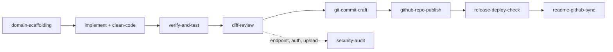

# Agent Skills Catalog

Skill adalah prosedur yang dapat dieksekusi agen: instruksi langkah demi langkah dalam `SKILL.md`, ditambah skrip dan template bila diperlukan. Rules menjawab **apa yang wajib**; skills menjawab **bagaimana menjalankannya**.

## Daftar Skill

| Skill | Tahap | Rule sumber | Skrip / Resource |
|---|---|---|---|
| [`domain-scaffolding`](./domain-scaffolding/SKILL.md) | 3 Design, 4 Plan | 16, 18, 19 | `resources/blueprint-template.md` |
| [`laravel-web-studio`](./laravel-web-studio/SKILL.md) | 3 Design, 5 Implement | 01, 02, 03, 10 | `references/`, `resources/`, `scripts/new-project.ps1`, `scripts/perf-check.ps1` |
| [`shadcn-admin-design-system`](./shadcn-admin-design-system/SKILL.md) | 5 Implement | 01, 19 | `resources/theme.css`, `resources/patterns.md` |
| [`clean-code-concise-docs`](./clean-code-concise-docs/SKILL.md) | 5 Implement | 06, 20 | - |
| [`verify-and-test`](./verify-and-test/SKILL.md) | 6 Verify | 04, 18 | `scripts/verify.ps1` |
| [`diff-review`](./diff-review/SKILL.md) | 7 Review | 05, 06, 12, 18 | `scripts/scan-diff.ps1` |
| [`security-audit`](./security-audit/SKILL.md) | 7 Review | 05, 19 §4 | `resources/audit-report-template.md` |
| [`git-commit-craft`](./git-commit-craft/SKILL.md) | 7 Review | 12, 12.1 | `templates/git/` |
| [`github-repo-publish`](./github-repo-publish/SKILL.md) | 8 Release | 11.1, 12.1 | `scripts/publish-repo.ps1` |
| [`release-deploy-check`](./release-deploy-check/SKILL.md) | 8 Release | 08, 09 | `scripts/check-deploy.ps1` |
| [`readme-github-sync`](./readme-github-sync/SKILL.md) | 9 Report | 11, 11.1, 18, 20 | `scripts/check-readme.ps1`, `scripts/sync-topics.ps1` |

## Alur Pemakaian Standar



## Instalasi

```powershell
# Antigravity / Gemini
powershell -ExecutionPolicy Bypass -File skills/install-skills.ps1 -Target "$HOME\.gemini\config\skills"

# Claude Code
powershell -ExecutionPolicy Bypass -File skills/install-skills.ps1 -Target "$HOME\.claude\skills"

# Hanya skill tertentu
powershell -ExecutionPolicy Bypass -File skills/install-skills.ps1 -Target "$HOME\.claude\skills" -Only diff-review,verify-and-test
```

Installer menyalin folder skill ke direktori target dan menimpa versi lama dengan nama yang sama. Skill lain di direktori target tidak disentuh.

## Konvensi Penulisan Skill

1. Satu folder per skill, nama kebab-case, berisi `SKILL.md` dengan frontmatter `name` dan `description`.
2. `description` menyebutkan **apa** yang dilakukan dan **kapan** dipakai, karena agen memilih skill berdasarkan teks ini.
3. Rujuk rule sumber; jangan menyalin isi rule secara utuh.
4. Skrip PowerShell harus kompatibel dengan Windows PowerShell 5.1, hanya karakter ASCII, memakai tag log `[INFO]`, `[WARN]`, `[ERROR]`, `[SUCCESS]`, dan mengembalikan exit code bukan nol saat gagal.
5. Skrip yang mengubah sistem eksternal wajib menyediakan `-DryRun`.
6. Setiap skrip diuji pada proyek nyata sebelum di-commit.
