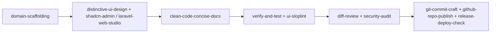
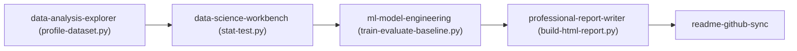

# Agent Skills Catalog

Skill adalah prosedur yang dapat dieksekusi oleh AI Coding Assistant: instruksi langkah demi langkah dalam `SKILL.md`, ditambah skrip otomatis (`scripts/`) dan template (`resources/`, `references/`). Rules menetapkan **apa yang wajib**; skills menetapkan **bagaimana menjalankannya secara teknis**.

---

## Daftar Lengkap 16 Skill

| # | Skill | Tahap Workflow | Rule Sumber | Skrip / Resource Utama |
|---|---|---|---|---|
| 1 | [`domain-scaffolding`](./domain-scaffolding/SKILL.md) | 3 Design, 4 Plan | 16, 18, 19 | `resources/blueprint-template.md` |
| 2 | [`distinctive-ui-design`](./distinctive-ui-design/SKILL.md) | 3 Design, 5 Implement | 01, 19 | `references/visual-archetypes.md`, `scripts/ui-sloplint.ps1` |
| 3 | [`shadcn-admin-design-system`](./shadcn-admin-design-system/SKILL.md) | 5 Implement | 01, 19 | `resources/theme.css`, `resources/patterns.md` |
| 4 | [`laravel-web-studio`](./laravel-web-studio/SKILL.md) | 3 Design, 5 Implement | 01, 02, 03, 10 | `references/`, `resources/`, `scripts/new-project.ps1`, `scripts/perf-check.ps1` |
| 5 | [`clean-code-concise-docs`](./clean-code-concise-docs/SKILL.md) | 5 Implement, 7 Review | 06, 19, 20 | `scripts/check-code-hygiene.ps1` |
| 6 | [`ml-model-engineering`](./ml-model-engineering/SKILL.md) | 3 Design, 5 Implement, 6 Verify | 17, 20 | `scripts/train-evaluate-baseline.py` |
| 7 | [`data-science-workbench`](./data-science-workbench/SKILL.md) | 3 Design, 5 Implement, 6 Verify | 15, 17 | `scripts/stat-test.py` |
| 8 | [`data-analysis-explorer`](./data-analysis-explorer/SKILL.md) | 2 Discover, 5 Implement | 15, 17, 20 | `scripts/profile-dataset.py` |
| 9 | [`professional-report-writer`](./professional-report-writer/SKILL.md) | 9 Report | 11, 19, 20 | `scripts/build-html-report.py` |
| 10 | [`verify-and-test`](./verify-and-test/SKILL.md) | 6 Verify | 04, 18 | `scripts/verify.ps1` |
| 11 | [`diff-review`](./diff-review/SKILL.md) | 7 Review | 05, 06, 12, 18 | `scripts/scan-diff.ps1` |
| 12 | [`security-audit`](./security-audit/SKILL.md) | 7 Review | 05, 19 §4 | `resources/audit-report-template.md` |
| 13 | [`git-commit-craft`](./git-commit-craft/SKILL.md) | 7 Review | 12, 12.1 | `templates/git/` |
| 14 | [`github-repo-publish`](./github-repo-publish/SKILL.md) | 8 Release | 11.1, 12.1 | `scripts/publish-repo.ps1` |
| 15 | [`release-deploy-check`](./release-deploy-check/SKILL.md) | 8 Release | 08, 09 | `scripts/check-deploy.ps1` |
| 16 | [`readme-github-sync`](./readme-github-sync/SKILL.md) | 9 Report | 11, 11.1, 18, 20 | `scripts/check-readme.ps1`, `scripts/sync-topics.ps1` |

---

## Alur Pemakaian Berdasarkan Domain Tugas

### A. Pengembangan Aplikasi Web & Sistem Domain


### B. Data Analysis, Data Science, & Machine Learning


---

## Instalasi Lintas Agen

```powershell
# Antigravity / Gemini (global)
powershell -ExecutionPolicy Bypass -File skills/install-skills.ps1 -Target "$HOME\.gemini\config\skills"

# Claude Code (global)
powershell -ExecutionPolicy Bypass -File skills/install-skills.ps1 -Target "$HOME\.claude\skills"

# Hanya skill tertentu
powershell -ExecutionPolicy Bypass -File skills/install-skills.ps1 -Target "$HOME\.claude\skills" -Only distinctive-ui-design,ml-model-engineering,data-science-workbench,data-analysis-explorer,professional-report-writer
```

---

## Konvensi Penulisan Skill

1. Satu folder per skill, nama kebab-case, berisi `SKILL.md` dengan frontmatter YAML `name` dan `description`.
2. Seluruh isi `SKILL.md` dan skrip wajib bebas emoji (Rule 20) dan menggunakan Bahasa Indonesia baku (KBBI/PUEBI) atau Technical English formal.
3. Skrip PowerShell (`.ps1`) kompatibel dengan Windows PowerShell 5.1 dan skrip Python (`.py`) menggunakan pustaka ilmiah standar (`numpy`, `pandas`, `scipy`, `scikit-learn`) tanpa instalasi paket tersembunyi (`--break-system-packages`).
4. Semua keluaran terminal skrip diawali tag formal `[INFO]`, `[SUCCESS]`, `[WARN]`, atau `[ERROR]`.
