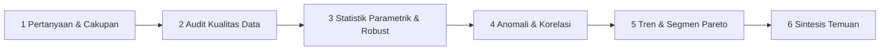

# Data Analysis Explorer: Rigorous Profiling, Anomaly Detection & Business Insights

Standar prosedur eksplorasi dan analisis data (*Exploratory Data Analysis*) yang memperbaiki kelemahan fatal pada repositori referensi (`1donatien0/data-analysis-skill`):
1. **Tanpa Sampling Merusak (*Non-Destructive Aggregation*):** `1donatien0/data-analysis-skill` memotong dataset $> 100.000$ baris menjadi $10.000$ baris acak sebelum menghitung `sum` dan deret waktu, sehingga total pendapatan dan volume menjadi salah total. Skill ini menghitung agregasi, total, dan statistik pada **seluruh baris dataset**.
2. **Tanpa Instalasi Paket Liar:** Dilarang menjalankan `pip install --break-system-packages` secara diam-diam di belakang layar.
3. **Statistik Tahan Pencilan (*Robust Statistics*):** Selalu menyertakan **Median**, **IQR (Q75 - Q25)**, **Kuantil P5/P95**, dan **Skewness** berdampingan dengan Mean dan SD agar kesimpulan tidak terdistorsi oleh *outlier*.
4. **Korelasi Ganda (Pearson & Spearman):** Menghitung korelasi linier (*Pearson* $r$) sekaligus korelasi peringkat monotonik (*Spearman* $\rho$) untuk menangkap hubungan non-linier.

---

## 1. Alur Kerja Analisis Data



### Langkah 1: Jalankan Profiler Dataset (`scripts/profile-dataset.py`)
```powershell
python skills/data-analysis-explorer/scripts/profile-dataset.py `
  --input data/reksadana.csv `
  --output-json scratch/profile_result.json
```
Skrip membaca CSV (mendeteksi delimiter `,`, `;`, `\t`, `|` dan encoding secara otomatis), TSV, JSON, Parquet, atau Excel, lalu menghasilkan:
- Metadata cakupan: jumlah baris penuh, kolom, duplikat baris, penggunaan memori, dan **rentang periode tanggal (awal s.d. akhir)**.
- Audit kualitas per kolom: persentase nilai hilang (*missingness*), nilai unik (*cardinality*), dan tipe data.
- Statistik numerik lengkap: `count`, `sum`, `mean`, `std`, `min`, `p05`, `p25`, `median`, `p75`, `p95`, `max`, `iqr`, `skewness`, serta histogram 10-bin.
- Deteksi pencilan ganda: **Tukey 1.5x IQR fence** dan **Extreme 3.0x IQR fence**.
- Statistik kategorikal: 15 kategori teratas beserta pangsa persentase dan rasio konsentrasi **Top-3 Share**.
- Pasangan korelasi terkuat (*Pearson* $r$ dan *Spearman* $\rho$).
- Agregasi deret waktu bulanan (`sum`, `mean`, `count`) pada seluruh baris.

---

## 2. Kaidah Interpretasi Kuantitatif Wajib

### 2.1 Kapan Menggunakan Mean vs Median
- Periksa nilai `skewness` setiap kolom numerik:
  - Jika $|\text{skewness}| \le 1.0$: distribusi relatif simetris; laporkan **Mean ± SD**.
  - Jika $|\text{skewness}| > 1.0$ (umum pada nilai transaksi, AUM, gaji, durasi): distribusi miring; **wajib** memimpin laporan dengan **Median (IQR: Q25–Q75)** dan sebutkan Mean sebagai pembanding.

### 2.2 Klasifikasi Kekuatan Korelasi
Jangan mengklaim adanya hubungan hanya karena angka korelasi bukan nol:
- $|r| < 0.30$: Sangat lemah / tidak bermakna praktis.
- $0.30 \le |r| < 0.50$: Lemah–moderat.
- $0.50 \le |r| < 0.70$: Moderat–kuat.
- $|r| \ge 0.70$: Kuat (periksa apakah ada variabel perancu / *confounder* atau hubungan definisional).
- Jika $|\rho_{\text{Spearman}} - r_{\text{Pearson}}| > 0.15$, hubungan bersifat **non-linier / monotonik** atau dipengaruhi pencilan ekstrem.

### 2.3 Standar Penulisan Insight Berorientasi Keputusan
Setiap poin temuan wajib mengikuti formula 4 bagian:
**[1. Kesimpulan Inti] + [2. Besaran Angka & Satuan] + [3. Pembanding / Konteks Periode] + [4. Implikasi / Tindakan]**.

- **Contoh Buruk (Kabur & Tanpa Konteks):**
  > *"Penjualan mengalami peningkatan yang cukup bagus pada akhir tahun dan produk Laptop mendominasi."*
- **Contoh Baik (Baku, Terukur, & Tajam):**
  > *"Pendapatan bersih kuartal IV mencapai Rp 1,42 miliar (+38,4% dibanding kuartal III), dengan 64,2% kontribusi berasal dari lini produk Laptop Pro (n = 412 unit). Ketergantungan tinggi pada satu SKU ini menuntut pengamanan stok pengaman minimal 3 minggu sebelum puncak permintaan November."*

---

## 3. Kewajiban Pencantuman Periode & Sumber Data
Setiap analisis data yang ditampilkan di README, aplikasi web, atau laporan eksekutif **wajib** mencantumkan secara eksplisit:
1. **Rentang waktu data** (contoh: *"Periode Data: Januari 2020 – Desember 2024"*).
2. **Jumlah observasi valid** ($N$ baris setelah pembersihan vs baris mentah).
3. **Definisi filter atau eksklusi** (misal: baris yang dikeluarkan karena nilai kosong atau di bawah batas minimum).
