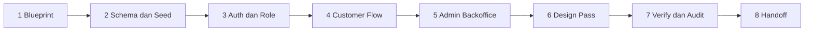

# Domain Scaffolding

Prosedur pelaksanaan Rule 16. Katalog fitur per arketipe ada di [`rules/16-autonomous-domain-archetypes-scaffolding.md`](../../rules/16-autonomous-domain-archetypes-scaffolding.md); skill ini mengatur **urutan kerja dan standar hasil akhir**.

Rule terkait: **16** (Archetypes), **05** (Security), **18** (Auth Boundaries, Clean Handoff), **19** (Anti-Slop UI, Mobile Ergonomics).
Skill pendukung: `shadcn-admin-design-system`, `laravel-web-studio`, `verify-and-test`, `security-audit`, `readme-github-sync`, `github-repo-publish`.

---

## 1. Prinsip

- **Jangan menanyakan kebutuhan dasar** (auth, keranjang, warna, font). Putuskan sendiri berdasarkan arketipe.
- Tanyakan hanya hal yang **tidak bisa ditebak dan berdampak besar**, misalnya integrasi pembayaran nyata atau stack yang diwajibkan klien.
- Hasil pertama harus **dapat dijalankan dan didemokan**, bukan kerangka kosong.

---

## 2. Pemilihan Arketipe dan Stack

| Permintaan pengguna | Arketipe (Rule 16) | Stack default |
|---|---|---|
| Toko buku, fashion, toko kue, toko bunga | A: E-Commerce | Laravel + Blade + Tailwind (gunakan `laravel-web-studio`) |
| Antrian klinik, servis, rumah sakit | B: Queue & Clinic | Laravel + React/Next untuk layar antrian real-time |
| Kasir, POS restoran/retail | C: POS | Laravel + Livewire atau React SPA |
| SaaS, langganan, multi-tenant | D: SaaS | Next.js + Prisma/Postgres atau Laravel |
| Kursus online, LMS | E: LMS | Laravel atau Next.js |
| Booking salon, bengkel, jasa, company profile | F: Service Booking | Laravel + Blade |

Bila repositori sudah memiliki stack, **ikuti stack yang ada**.

---

## 3. Urutan Kerja

### 3.1 Blueprint
Tulis `docs/BLUEPRINT.md` memakai [`resources/blueprint-template.md`](resources/blueprint-template.md): arketipe, persona, sitemap customer dan admin, entitas, dan alur utama.

### 3.2 Schema dan Seed
- Skema ternormalisasi (3NF), foreign key, index pada kolom pencarian dan filter (Rule 03).
- Seeder berisi **6 sampai 12 item domain** dengan nama, deskripsi, harga, dan stok yang realistis dalam bahasa Indonesia.
- Setiap item memiliki **gambar**. Sumber: `https://images.unsplash.com/...` dengan parameter ukuran, atau aset lokal di `public/images/seed/`. Jangan memakai placeholder abu-abu.
- Akun demo:

| Peran | Email | Password |
|---|---|---|
| Admin | `admin@example.com` | `password123` |
| User | `user@example.com` | `password123` |

### 3.3 Auth dan Role
- Peran minimal: `admin`, `user`. Tamu tidak login.
- Aksi member (keranjang, checkout, booking, riwayat) **dikunci di server** dan **disembunyikan di UI** bagi tamu (Rule 18).
- Rute admin memakai prefix terobfuskasi, misalnya `/panel-7f3k/`, bukan `/admin` (Rule 05), dan dilindungi middleware role.

### 3.4 Customer Flow
Beranda, katalog dengan pencarian dan filter, detail item, alur transaksi utama arketipe (checkout, ambil nomor antrian, booking slot), dan halaman riwayat milik user.

### 3.5 Admin Backoffice
Dashboard KPI (pendapatan, transaksi, item terlaris), CRUD entitas utama dengan tabel ber-paginasi, pencarian, dan filter, manajemen status transaksi, serta manajemen pengguna.

### 3.6 Design Pass
Terapkan `shadcn-admin-design-system` (slate oklch, sidebar 16rem, header sticky blur). Patuhi Rule 19: bento grid asimetris bila relevan, tanpa gradient ungu acak, target sentuh minimal 44 px, bottom sheet di ponsel, dan `env(safe-area-inset-*)`. Copy berbahasa Indonesia yang lugas.

### 3.7 Verify dan Audit
- `verify-and-test`: minimal test untuk otorisasi (tamu ditolak, user tidak dapat mengakses data user lain, user tidak dapat membuka panel admin) dan perhitungan bisnis utama.
- `security-audit` Fase 1 dan 2 secara ringkas.

### 3.8 Handoff
Lihat Bagian 4.

---

## 4. Checklist Clean Production Handoff (Rule 18)

- [ ] Form login **tidak** terisi otomatis dengan kredensial demo
- [ ] Tidak ada tombol "login sebagai admin", bypass auth, atau rute debug
- [ ] Akun demo hanya didokumentasikan di README, bagian "Akun Demo"
- [ ] `APP_DEBUG=false` dan `.env.example` lengkap tanpa nilai rahasia
- [ ] Seeder demo dipisah (`DemoSeeder`) agar dapat dinonaktifkan di produksi
- [ ] README lulus `readme-github-sync` dan menyertakan screenshot customer dan admin
- [ ] `diff-review -All` tanpa `[BLOCK]`

---

## 5. Laporan Akhir

Sampaikan: arketipe dan stack yang dipilih beserta alasan singkat, cara menjalankan (perintah yang dapat disalin), URL customer dan admin (termasuk prefix terobfuskasi), akun demo, hasil verifikasi, dan daftar fitur yang sengaja ditunda.
