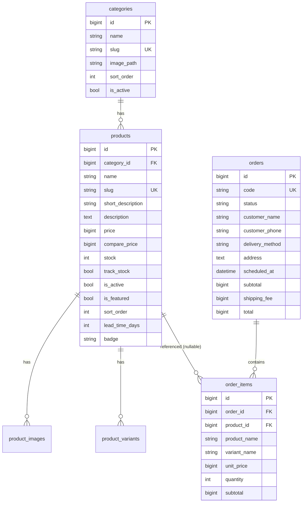
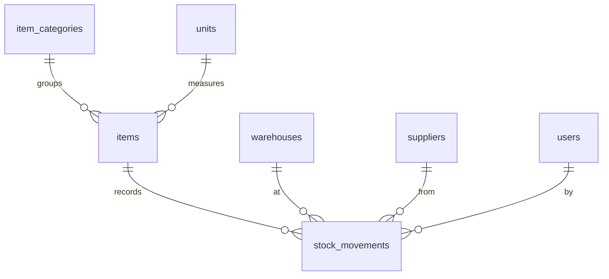

# 05 — Desain Database (MySQL 8 di Laragon)

Tujuan: skema yang **benar secara data, cepat untuk query yang sering, dan mudah
dikembangkan**. Rancang dari *query yang akan dijalankan*, bukan dari form.

---

## 1. Konvensi Wajib

| Aspek | Aturan |
|---|---|
| Engine/charset | InnoDB, `utf8mb4` / `utf8mb4_unicode_ci` (default Laravel) |
| Primary key | `id()` BIGINT UNSIGNED auto increment. UUID/ULID hanya untuk ID yang diekspos publik & perlu tak-tertebak (gunakan kolom `code` terpisah lebih sederhana). |
| Nama tabel/kolom | Bahasa Inggris, snake_case, tabel jamak (`products`, `order_items`) — konsisten dengan konvensi Eloquent. |
| Uang | `unsignedBigInteger('price')` dalam **rupiah utuh**. Jangan `float`/`double`. `decimal(15,2)` hanya jika benar-benar perlu sen. |
| Kuantitas | `integer` (bisa negatif hanya di ledger); `decimal(12,3)` bila satuan kg/liter. |
| Status | `string('status', 20)` + PHP backed Enum + index. Hindari MySQL `ENUM` (sulit dimigrasi). |
| Boolean | `boolean('is_active')->default(true)` |
| Urutan tampil | `unsignedInteger('sort_order')->default(0)` |
| Slug | `string('slug')->unique()` |
| Foreign key | `foreignId('category_id')->constrained()` + aksi delete yang disengaja (lihat §3). |
| Soft delete | Entitas katalog/master (`products`, `categories`, `items`). Jangan di ledger/transaksi. |
| Timestamps | Selalu `timestamps()`; tanggal bisnis terpisah (`scheduled_at`, `published_at`). |
| JSON | Hanya untuk data fleksibel yang tidak difilter (mis. `meta`, opsi tambahan). |
| Teks panjang | `text` untuk deskripsi; `longText` untuk isi artikel. |

---

## 2. Skema Arketipe A (Katalog + Order WA)



Tabel pendukung: `settings` (key UK, value text), `testimonials` (name, city, content,
rating, image_path, is_active, sort_order), `banners`, `faqs` (question, answer, sort_order),
`pages` (statis, opsional).

### Migration inti
```php
Schema::create('categories', function (Blueprint $table) {
    $table->id();
    $table->string('name', 100);
    $table->string('slug', 120)->unique();
    $table->string('description', 300)->nullable();
    $table->string('image_path')->nullable();
    $table->unsignedInteger('sort_order')->default(0);
    $table->boolean('is_active')->default(true);
    $table->timestamps();
    $table->softDeletes();
    $table->index(['is_active', 'sort_order']);
});

Schema::create('products', function (Blueprint $table) {
    $table->id();
    $table->foreignId('category_id')->constrained()->restrictOnDelete();
    $table->string('name', 150);
    $table->string('slug', 170)->unique();
    $table->string('short_description', 255)->nullable();
    $table->text('description')->nullable();
    $table->unsignedBigInteger('price');
    $table->unsignedBigInteger('compare_price')->nullable(); // harga coret
    $table->boolean('track_stock')->default(false);
    $table->integer('stock')->default(0);
    $table->unsignedSmallInteger('lead_time_days')->default(0); // H+n
    $table->string('badge', 30)->nullable(); // best_seller | new | pre_order
    $table->boolean('is_active')->default(true);
    $table->boolean('is_featured')->default(false);
    $table->unsignedInteger('sort_order')->default(0);
    $table->unsignedInteger('sold_count')->default(0); // untuk sort "Terpopuler"
    $table->json('meta')->nullable();
    $table->timestamps();
    $table->softDeletes();

    // index komposit mengikuti query katalog yang paling sering
    $table->index(['is_active', 'category_id', 'sort_order']);
    $table->index(['is_active', 'is_featured']);
    $table->index(['is_active', 'price']);
    $table->fullText(['name', 'short_description']); // pencarian (MySQL)
});

Schema::create('product_images', function (Blueprint $table) {
    $table->id();
    $table->foreignId('product_id')->constrained()->cascadeOnDelete();
    $table->string('path');               // base path tanpa suffix ukuran
    $table->unsignedSmallInteger('width');
    $table->unsignedSmallInteger('height');
    $table->string('alt', 200)->nullable();
    $table->unsignedSmallInteger('sort_order')->default(0);
    $table->timestamps();
    $table->index(['product_id', 'sort_order']);
});

Schema::create('product_variants', function (Blueprint $table) {
    $table->id();
    $table->foreignId('product_id')->constrained()->cascadeOnDelete();
    $table->string('name', 100);          // "Diameter 20 cm"
    $table->unsignedBigInteger('price');
    $table->integer('stock')->default(0);
    $table->boolean('is_active')->default(true);
    $table->unsignedSmallInteger('sort_order')->default(0);
    $table->timestamps();
    $table->index(['product_id', 'is_active', 'sort_order']);
});

Schema::create('orders', function (Blueprint $table) {
    $table->id();
    $table->string('code', 20)->unique();
    $table->string('status', 20)->default('pending');
    $table->string('customer_name', 100);
    $table->string('customer_phone', 20);
    $table->string('delivery_method', 20); // pickup | delivery
    $table->text('address')->nullable();
    $table->dateTime('scheduled_at')->nullable();
    $table->string('payment_method', 20)->nullable();
    $table->text('note')->nullable();
    $table->unsignedBigInteger('subtotal');
    $table->unsignedBigInteger('shipping_fee')->default(0);
    $table->unsignedBigInteger('discount')->default(0);
    $table->unsignedBigInteger('total');
    $table->timestamp('wa_clicked_at')->nullable();
    $table->timestamps();
    $table->index(['status', 'created_at']);
    $table->index('customer_phone');
    $table->index('scheduled_at');
});

Schema::create('order_items', function (Blueprint $table) {
    $table->id();
    $table->foreignId('order_id')->constrained()->cascadeOnDelete();
    $table->foreignId('product_id')->nullable()->constrained()->nullOnDelete();
    $table->foreignId('product_variant_id')->nullable()->constrained()->nullOnDelete();
    $table->string('product_name', 150);  // SNAPSHOT — histori tetap benar walau produk diubah
    $table->string('variant_name', 100)->nullable();
    $table->unsignedBigInteger('unit_price');
    $table->unsignedInteger('quantity');
    $table->unsignedBigInteger('subtotal');
    $table->string('note', 255)->nullable(); // tulisan di kue / kartu ucapan
    $table->timestamps();
});

Schema::create('settings', function (Blueprint $table) {
    $table->id();
    $table->string('key', 100)->unique();
    $table->text('value')->nullable();
    $table->timestamps();
});
```

---

## 3. Skema Arketipe C (Inventaris) — Pola Ledger

**Jangan** hanya menyimpan angka stok lalu meng-update-nya. Simpan setiap pergerakan
di `stock_movements` (sumber kebenaran, audit trail), dan simpan `items.stock` sebagai
**cache saldo** yang diperbarui dalam transaksi yang sama.



```php
Schema::create('items', function (Blueprint $table) {
    $table->id();
    $table->foreignId('item_category_id')->constrained()->restrictOnDelete();
    $table->foreignId('unit_id')->constrained()->restrictOnDelete();
    $table->string('sku', 50)->unique();
    $table->string('barcode', 64)->nullable()->unique();
    $table->string('name', 150);
    $table->integer('stock')->default(0);          // cache saldo
    $table->unsignedInteger('min_stock')->default(0);
    $table->unsignedBigInteger('purchase_price')->default(0);
    $table->unsignedBigInteger('selling_price')->default(0);
    $table->boolean('is_active')->default(true);
    $table->timestamps();
    $table->softDeletes();
    $table->index(['is_active', 'item_category_id']);
    $table->index('name');
});

Schema::create('stock_movements', function (Blueprint $table) {
    $table->id();
    $table->foreignId('item_id')->constrained()->restrictOnDelete();
    $table->foreignId('warehouse_id')->nullable()->constrained()->restrictOnDelete();
    $table->foreignId('supplier_id')->nullable()->constrained()->nullOnDelete();
    $table->foreignId('user_id')->constrained()->restrictOnDelete();
    $table->string('type', 20);                 // in | out | adjustment
    $table->integer('quantity');                // bertanda: +masuk, -keluar
    $table->integer('balance_after');           // saldo setelah movement (kartu stok cepat)
    $table->string('reference', 60)->nullable();// no faktur / surat jalan
    $table->string('note', 255)->nullable();
    $table->timestamp('moved_at')->useCurrent();
    $table->timestamps();
    $table->index(['item_id', 'moved_at']);
    $table->index(['type', 'moved_at']);
});
```
Stok minimum: query `whereColumn('stock', '<=', 'min_stock')`. Multi-gudang penuh →
tambahkan tabel `item_warehouse` (item_id, warehouse_id, stock) sebagai cache per gudang.

### Action pencatatan stok (aman dari race condition)
```php
namespace App\Actions;

use App\Enums\StockMovementType;
use App\Models\{Item, StockMovement};
use Illuminate\Support\Facades\DB;
use Illuminate\Validation\ValidationException;

class RecordStockMovement
{
    public function handle(int $itemId, StockMovementType $type, int $qty, int $userId, array $extra = []): StockMovement
    {
        return DB::transaction(function () use ($itemId, $type, $qty, $userId, $extra) {
            $item = Item::whereKey($itemId)->lockForUpdate()->firstOrFail();

            $signed = match ($type) {
                StockMovementType::In => abs($qty),
                StockMovementType::Out => -abs($qty),
                StockMovementType::Adjustment => $qty, // selisih bertanda
            };

            $newBalance = $item->stock + $signed;
            if ($newBalance < 0) {
                throw ValidationException::withMessages([
                    'quantity' => "Stok {$item->name} tidak cukup (tersisa {$item->stock}).",
                ]);
            }

            $item->update(['stock' => $newBalance]);

            return $item->movements()->create([
                'type' => $type,
                'quantity' => $signed,
                'balance_after' => $newBalance,
                'user_id' => $userId,
                ...$extra,
            ]);
        });
    }
}
```

## 4. Skema Arketipe D (Informasi/CMS)
`posts` (title, slug UK, excerpt, body longText, cover_path, category_id, status,
published_at, index `[status, published_at]`), `post_categories`, `galleries` +
`gallery_photos`, `events` (title, slug, starts_at, ends_at, location; index `starts_at`),
`documents` (title, file_path, size, downloads), `pages` (slug UK, title, body).

---

## 5. Strategi Index
1. Index mengikuti klausa `WHERE` → `ORDER BY` dalam urutan itu (kolom equality dulu,
   lalu range/sort). Contoh query katalog
   `where is_active=1 and category_id=? order by sort_order` → index `(is_active, category_id, sort_order)`.
2. Setiap FK otomatis ter-index oleh `constrained()`; jangan duplikasi.
3. Jangan index kolom yang jarang difilter atau kardinalitas sangat rendah sendirian.
4. Verifikasi dengan `EXPLAIN` (HeidiSQL / `DB::select('EXPLAIN ...')`) untuk query
   halaman utama; pastikan `type` bukan `ALL` pada tabel besar.
5. Pencarian: data < 5.000 baris → `LIKE 'kata%'` atau `%kata%` sudah cukup;
   lebih besar → `whereFullText()` (perhatikan minimal panjang token InnoDB = 3)
   atau Laravel Scout + database/Meilisearch.

---

## 6. Pola Query Eloquent yang Wajib
```php
// AppServiceProvider::boot()
Model::shouldBeStrict(! app()->isProduction()); // lazy loading, silent attribute discard, missing attribute → exception di lokal
```
- Eager load relasi yang ditampilkan: `Product::with(['category:id,name,slug', 'coverImage'])`.
- Pilih kolom yang dipakai untuk list: `->select(['id','category_id','name','slug','price','compare_price','badge'])`.
- Relasi gambar sampul: `hasOne(ProductImage::class)->ofMany('sort_order', 'min')` sebagai `coverImage`.
- Hitung tanpa memuat: `withCount('products')`, agregat `withSum`.
- List publik: `simplePaginate()` atau `paginate()`; `->withQueryString()`.
- Ekspor/laporan besar: `lazy()` / `cursor()` + `response()->streamDownload()`.
- Update counter atomik: `Product::whereKey($id)->increment('sold_count', $qty)`.
- Jangan query di Blade atau di dalam loop.

---

## 7. Seeder & Factory
- Faker lokal: `APP_FAKER_LOCALE=id_ID`.
- Seeder berlapis: `SettingSeeder` (nama usaha, WA, jam buka), `CategorySeeder`,
  `ProductSeeder` (data realistis dari playbook industri, bukan kalimat acak),
  `TestimonialSeeder`, `AdminUserSeeder` (email & password dari `.env`, contoh
  `ADMIN_EMAIL`, `ADMIN_PASSWORD`).
- Gambar dummy diproses lewat `ImageService` agar varian ukuran tersedia.
- Factory harus valid untuk test (state `inactive()`, `outOfStock()`, `featured()`).

## 8. Migrasi yang Aman
- Jangan edit migration yang sudah dijalankan di produksi; buat migration baru.
- Lokal boleh `php artisan migrate:fresh --seed`.
- **Jangan pernah** menjalankan `migrate:fresh`, `db:wipe`, atau `DROP` pada database
  produksi/klien tanpa konfirmasi eksplisit user dan backup.
