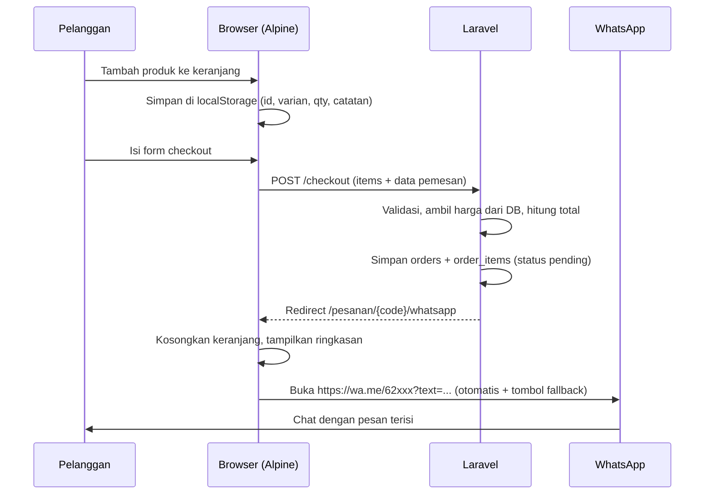

# 07 — Integrasi WhatsApp (Template Checkout Awal)

Model: **order tercatat di database → pelanggan diarahkan ke WhatsApp admin dengan
pesan terformat yang memuat kode order**. Admin mengonfirmasi ongkir & pembayaran di
chat, lalu memperbarui status di panel. Tanpa API berbayar, tanpa payment gateway.

Kenapa simpan ke DB dulu? Agar (1) harga terverifikasi server, (2) admin punya
rekap order & omzet, (3) bisa follow-up order yang tidak jadi chat, (4) siap
di-upgrade ke payment gateway kelak.

---

## 1. Alur



Jalur cepat "Pesan Langsung via WhatsApp" di detail produk = checkout berisi 1 item
(form ringkas di bottom sheet atau langsung ke halaman checkout dengan item tersebut).

Untuk arketipe B (jasa): form booking memakai alur yang sama (tabel `bookings`).
Untuk tanya-tanya umum: tombol WA dengan pesan sapaan + konteks halaman
("Halo, saya ingin tanya tentang *Buket Mawar 12 Tangkai*").

---

## 2. Service

Salin [resources/WhatsAppService.php](../resources/WhatsAppService.php) ke
`app/Services/WhatsAppService.php`. Fitur:
- `normalizePhone()` — `0812-3456-7890`, `+62 812…`, `812…` → `6281234567890`.
- `link($phone, $message)` — `https://wa.me/{nomor}?text={rawurlencode(pesan)}`.
- `orderMessage(Order $order)` — pesan terformat dari template.
- `adminLink(?string $message)` — memakai nomor admin dari settings.

Aturan format pesan:
- Gunakan format WhatsApp: `*tebal*`, `_miring_`, baris baru `\n` (di-encode `%0A`
  oleh `rawurlencode`).
- **Jangan pakai emoji yang tidak umum**; beberapa perangkat lama merusak encoding.
  Emoji dasar (🛒 📅 📍) aman, tetapi gunakan secukupnya.
- Panjang URL total usahakan < 2.000 karakter; jika item sangat banyak, ringkas
  (tampilkan 10 item pertama + "dan N item lainnya — detail: {link order}").
- Sertakan **kode order** dan **link status order** (signed URL) agar admin bisa
  membuka detailnya.

Contoh hasil pesan:
```
Halo *Toko Kue Kita*, saya ingin memesan:

*Kode Order:* ORD-261020-K7QZ

1. Bolu Pandan Keju (20 cm) x1 = Rp185.000
   Catatan: "Selamat Ulang Tahun Alya"
2. Kue Kering Nastar 500 g x2 = Rp240.000

*Subtotal:* Rp425.000
_Ongkir menyusul dari admin._

*Nama:* Rina
*Pengiriman:* Diantar — Jl. Merdeka No. 10, Bandung
*Jadwal:* Sabtu, 24 Okt 2026, 10:00
*Pembayaran:* Transfer/QRIS

Mohon konfirmasi ketersediaan & total ongkirnya. Terima kasih!
```
Template header/penutup bisa diedit admin di Settings (`wa_order_greeting`,
`wa_order_closing`), dengan placeholder `{store_name}`, `{code}`.

---

## 3. Keranjang (Alpine store + localStorage)

```js
// resources/js/cart.js
import Alpine from 'alpinejs'
import persist from '@alpinejs/persist'

Alpine.plugin(persist)

Alpine.store('cart', {
  items: Alpine.$persist([]).as('cart_v1'),
  // item: { key, product_id, variant_id, name, variant, price, image, qty, note }
  // price HANYA untuk tampilan; server menghitung ulang.

  get count() { return this.items.reduce((n, i) => n + i.qty, 0) },
  get subtotal() { return this.items.reduce((n, i) => n + i.price * i.qty, 0) },

  add(product, qty = 1) {
    const key = `${product.product_id}:${product.variant_id ?? 0}:${product.note ?? ''}`
    const found = this.items.find(i => i.key === key)
    found ? (found.qty = Math.min(found.qty + qty, 99)) : this.items.push({ ...product, key, qty })
    window.dispatchEvent(new CustomEvent('toast', { detail: `${product.name} ditambahkan ke keranjang` }))
  },
  update(key, qty) {
    const item = this.items.find(i => i.key === key)
    if (item) item.qty = Math.max(1, Math.min(qty, 99))
  },
  remove(key) { this.items = this.items.filter(i => i.key !== key) },
  clear() { this.items = [] },
})
```
```js
// resources/js/app.js
import Alpine from 'alpinejs'
import focus from '@alpinejs/focus'
import './cart'

Alpine.plugin(focus)
window.Alpine = Alpine
Alpine.start()
```
- Format rupiah di JS: `new Intl.NumberFormat('id-ID', { style: 'currency', currency: 'IDR', maximumFractionDigits: 0 }).format(n)`.
- Versi key (`cart_v1`) dinaikkan bila struktur berubah.
- Saat halaman keranjang/checkout dibuka, opsional `POST /keranjang/validasi` untuk
  menyegarkan harga/stok terbaru dan menandai item yang tidak tersedia.

Form checkout mengirim item sebagai hidden inputs:
```blade
<template x-for="(item, i) in $store.cart.items" :key="item.key">
  <div>
    <input type="hidden" :name="`items[${i}][product_id]`" :value="item.product_id">
    <input type="hidden" :name="`items[${i}][variant_id]`" :value="item.variant_id ?? ''">
    <input type="hidden" :name="`items[${i}][qty]`" :value="item.qty">
    <input type="hidden" :name="`items[${i}][note]`" :value="item.note ?? ''">
  </div>
</template>
```

---

## 4. Request, Controller, Route

```php
// app/Http/Requests/StoreOrderRequest.php
public function rules(): array
{
    return [
        'customer_name'   => ['required', 'string', 'max:100'],
        'customer_phone'  => ['required', 'string', 'regex:/^(\+62|62|0)8[0-9]{7,12}$/'],
        'delivery_method' => ['required', 'in:pickup,delivery'],
        'address'         => ['required_if:delivery_method,delivery', 'nullable', 'string', 'max:500'],
        'scheduled_at'    => ['required', 'date', 'after_or_equal:'.now()->addDays((int) setting('lead_time_days', 1))->startOfDay()],
        'payment_method'  => ['required', 'in:transfer,qris,cod'],
        'note'            => ['nullable', 'string', 'max:500'],
        'items'                => ['required', 'array', 'min:1', 'max:30'],
        'items.*.product_id'   => ['required', 'integer', 'exists:products,id'],
        'items.*.variant_id'   => ['nullable', 'integer', 'exists:product_variants,id'],
        'items.*.qty'          => ['required', 'integer', 'min:1', 'max:99'],
        'items.*.note'         => ['nullable', 'string', 'max:150'],
        'website'              => ['prohibited'], // honeypot
    ];
}

protected function prepareForValidation(): void
{
    $this->merge(['customer_phone' => preg_replace('/[\s\-().]/', '', (string) $this->customer_phone)]);
}

public function messages(): array
{
    return [
        'customer_phone.regex' => 'Nomor WhatsApp tidak valid. Contoh: 081234567890.',
        'items.required' => 'Keranjang masih kosong.',
        'scheduled_at.after_or_equal' => 'Tanggal terlalu dekat. Pesanan minimal H+:days.',
    ];
}
```
(Ganti `:days` sesuai setting atau bangun pesan dinamis di method `messages()`.)

```php
// app/Http/Controllers/Public/CheckoutController.php
public function store(StoreOrderRequest $request, CreateOrder $createOrder)
{
    $order = $createOrder->handle($request->validated());

    return redirect()->to(URL::signedRoute('orders.whatsapp', $order));
}

public function whatsapp(Order $order, WhatsAppService $wa)
{
    $waUrl = $wa->link(setting('whatsapp_number'), $wa->orderMessage($order));

    return view('pages.checkout.whatsapp', compact('order', 'waUrl'));
}
```
```php
// routes/web.php
Route::get('/checkout', [CheckoutController::class, 'create'])->name('checkout.create');
Route::post('/checkout', [CheckoutController::class, 'store'])
    ->middleware('throttle:checkout')->name('checkout.store');
Route::get('/pesanan/{order:code}/whatsapp', [CheckoutController::class, 'whatsapp'])
    ->middleware('signed')->name('orders.whatsapp');
Route::post('/pesanan/{order:code}/wa-klik', [CheckoutController::class, 'trackClick'])
    ->middleware(['signed', 'throttle:20,1'])->name('orders.wa-click');
```

Halaman `pages/checkout/whatsapp.blade.php`:
- Kosongkan keranjang lalu coba buka WhatsApp otomatis (satu `x-init` saja):
  `x-init="$store.cart.clear(); setTimeout(() => window.location.href = @js($waUrl), 800)"`.
- Tampilkan kode order, ringkasan, tombol besar "Buka WhatsApp" (`href="{{ $waUrl }}"`,
  `rel="noopener"`) sebagai fallback, dan instruksi "Jika WhatsApp tidak terbuka, tekan tombol di atas".
- Tracking klik opsional: `navigator.sendBeacon` ke route `orders.wa-click` (isi `wa_clicked_at`).
  Kirim `FormData` berisi `_token` (`@csrf` value) agar tidak kena 419.

---

## 5. Admin
- Daftar order: filter status/tanggal, tombol "Chat Pelanggan" (link WA ke
  `customer_phone` dengan pesan konfirmasi berisi total + ongkir + info rekening).
- Ubah status cepat (Menunggu → Dikonfirmasi → Diproses → Selesai/Dibatalkan).
- Input ongkir & diskon → total diperbarui → kirim ulang rincian via WA.
- Saat status `confirmed`: kurangi stok (jika `track_stock`) dan `increment('sold_count')`
  dalam transaksi.

---

## 6. Tombol WA di Seluruh Situs
- `x-wa-float` (kanan bawah) — pesan sapaan + nama halaman.
- Header: CTA "Pesan via WA" (desktop).
- Detail produk: "Tanya produk ini" (pesan berisi nama + URL produk).
- Kontak & footer: nomor tertulis lengkap + tombol.
- Gunakan satu sumber nomor: `setting('whatsapp_number')`.

## 7. Upgrade di Masa Depan (jangan dibangun kecuali diminta)
- WhatsApp Business Platform (Cloud API) untuk notifikasi otomatis ke admin/pelanggan.
- Payment gateway (Midtrans/Xendit/Tripay): status order `awaiting_payment` → webhook
  → `confirmed`. Skema `orders` di atas sudah siap (kolom `payment_method`, `status`, `total`).
- Ongkir otomatis (RajaOngkir/Biteship) bila pengiriman antar kota.
