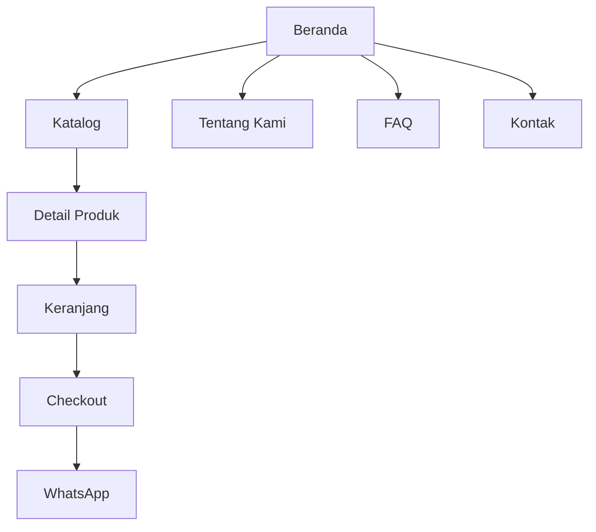
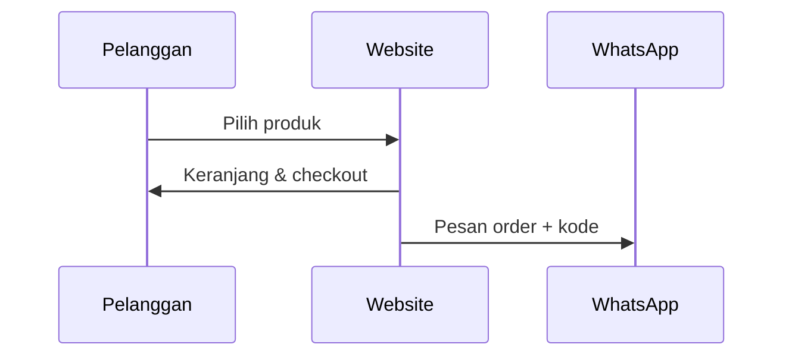
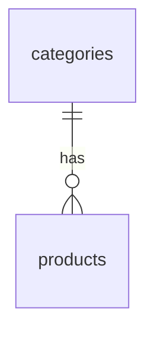

# Blueprint Proyek — [NAMA USAHA]

> Versi 1.0 · [tanggal] · Status: Draft / Disetujui

## 1. Ringkasan
- **Usaha:** [nama] — [jenis usaha] di [kota]
- **Arketipe:** A Katalog+Order / B Jasa / C Inventaris / D Informasi
- **Tujuan utama website:** [mis. meningkatkan order via WhatsApp 2× dalam 3 bulan]
- **Satu kalimat positioning:** "[Untuk siapa] yang [butuh apa], [nama] adalah [kategori] yang [diferensiasi]."

## 2. Assumption Log
| # | Asumsi | Alasan | Perlu dikonfirmasi? |
|---|---|---|---|
| 1 | Pembayaran transfer/QRIS manual via WA | Umum di UMKM, tanpa biaya gateway | Ya |
| 2 | … | … | … |

## 3. Target Pengguna
- **Persona utama:** [nama, usia, konteks, kebutuhan, kekhawatiran, perangkat]
- **Persona kedua:** …
- **Jobs-to-be-done:** "Ketika [situasi], saya ingin [motivasi], sehingga [hasil]."

## 4. Arah Brand & Desain
- **Brand attributes (3):** [hangat] · [homemade] · [premium]
- **Moodboard verbal:** …
- **Palet:** brand `#…` · accent `#…` · surface `#…` · ink `#…` (skala lengkap di `app.css`)
- **Tipografi:** Display [font] · Body [font]
- **Radius & bentuk:** …
- **Imagery:** rasio, latar, pencahayaan
- **Signature element:** …
- **Nada copy:** Kamu / Anda, contoh kalimat

## 5. Sitemap

## 6. Outline Konten per Halaman
### Beranda
| Section | Headline / isi | CTA |
|---|---|---|
| Hero | "…" | Pesan via WhatsApp / Lihat Katalog |
| … | … | … |

### [Halaman lain]
…

## 7. Fitur
| Fitur | Prioritas (MVP/Lanjutan) | Catatan |
|---|---|---|
| Katalog + filter kategori | MVP | |
| Checkout WhatsApp | MVP | |
| … | | |

## 8. Alur Utama

## 9. Model Data (ERD)

## 10. Admin
- Entitas yang dikelola: …
- Role: Admin / Staf
- Implementasi: Filament / Custom

## 11. Keputusan Teknis
| Aspek | Keputusan |
|---|---|
| Laravel / PHP | [versi] / [versi] |
| Tailwind | v4 / v3 |
| Interaktivitas | Alpine.js (+ plugin: …) |
| Database | MySQL 8 (Laragon) |
| Hosting target | Shared hosting / VPS |

## 12. Performance Budget
LCP < 2.0 s · CLS < 0.05 · INP < 200 ms · JS < 60 KB · CSS < 25 KB · Home < 900 KB · ≤ 10 query/halaman

## 13. Milestone
| # | Milestone | Output |
|---|---|---|
| 1 | Blueprint disetujui | dokumen ini |
| 2 | Design system & styleguide | `/_styleguide`, screenshot |
| 3 | Halaman publik | … |
| 4 | Admin & WA flow | … |
| 5 | QA & deploy | laporan QA |

## 14. Konten yang Wajib Diganti Klien
- [ ] Logo & foto produk asli
- [ ] Harga final
- [ ] Testimoni asli
- [ ] Nomor WA, alamat, jam buka

## 15. Pertanyaan Terbuka (maks. 5)
1. …
