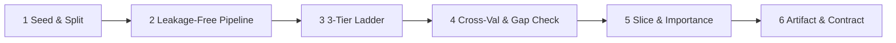

# Machine Learning Model Engineering & MLOps

Prosedur rekayasa model Machine Learning berstandar produksi sesuai **Rule 17**. Skill ini dirancang untuk mencegah empat kesalahan paling fatal pada kode ML yang dihasilkan AI:
1. **Data Leakage:** Melakukan `fit_transform` pada seluruh data sebelum *split*, atau melakukan `fit` ulang pada *test set*.
2. **Tanpa Baseline:** Langsung melatih model kompleks (XGBoost / Deep Learning) tanpa membuktikan keunggulan statistik terhadap *Dummy Baseline* dan *Linear Baseline*.
3. **Metrik Tunggal Semu (*Aggregate Metric Fallacy*):** Hanya melaporkan akurasi rata-rata tanpa *PR-AUC*, pemeriksaan *overfitting gap*, dan analisis irisan data (*slice analysis*).
4. **API Usang:** Menggunakan sintaks `scikit-learn` lama seperti `make_scorer(..., needs_proba=True)` yang gagal pada `scikit-learn >= 1.4` (wajib menggunakan `response_method="predict_proba"`).

---

## 1. Alur Kerja Eksekusi Cepat

Untuk melatih dan membandingkan model acuan (*baseline*) hingga model utama secara otomatis dan bebas bocor pada dataset tabular (`.csv` atau `.parquet`), jalankan:

```powershell
# Klasifikasi biner atau multikelas
python skills/ml-model-engineering/scripts/train-evaluate-baseline.py `
  --input data/processed/dataset.csv `
  --target churn `
  --task classification `
  --slice-col segment `
  --output-dir models/churn_v1

# Regresi kontinu (dengan pembagian kronologis berdasarkan kolom tanggal)
python skills/ml-model-engineering/scripts/train-evaluate-baseline.py `
  --input data/processed/sales.csv `
  --target revenue `
  --task regression `
  --time-col transaction_date `
  --output-dir models/revenue_v1
```

Skrip menjalankan: penguncian seed (`SEED = 42`), pembagian data sesuai topologi, pembuatan `ColumnTransformer` + `Pipeline`, pelatihan 3 tingkat model (*Dummy*, *Linear/Ridge/Logistic*, *HistGradientBoosting*), deteksi *overfitting gap*, evaluasi per segmen (*slice analysis*), perhitungan *permutation importance*, serta penyimpanan `model.joblib` dan `model_manifest.json`.

---

## 2. Enam Tahap Rekayasa Model Wajib



### 2.1 Penguncian Seed & Strategi Pembagian Data (*Split Topology*)
Kunci seluruh generator angka acak di baris paling atas (`PYTHONHASHSEED`, `random`, `numpy`). Pilih strategi pembagian data berdasarkan struktur domain:

| Karakteristik Dataset | Strategi Split Wajib | Alasan Teknis |
|---|---|---|
| Klasifikasi (terutama kelas timpang) | `train_test_split(..., stratify=y)` + `StratifiedKFold` | Menjaga proporsi kelas minoritas identik di train, val, dan test |
| Deret waktu / log transaksi berurutan | Urutkan waktu, potong kronologis + `TimeSeriesSplit` | Mencegah *lookahead bias* (data masa depan membocori masa lalu) |
| Satu entitas memiliki banyak baris (user_id, patient_id) | `GroupShuffleSplit` + `GroupKFold( groups=entity_id )` | Mencegah *group leakage* (entitas yang sama muncul di train dan test) |
| Regresi kontinu umum |Stratifikasi pada kuantil target (`pd.qcut(y, q=5)`) | Menjaga distribusi target tidak berat sebelah pada sampel kecil |

### 2.2 Arsitektur Pipeline Anti-Leakage (`scikit-learn >= 1.4`)
**DILARANG KERAS** memanggil `scaler.fit(X)` atau `imputer.fit(X)` sebelum pembagian train/test, dan **DILARANG** memanggil `fit` pada `X_test`. Seluruh transformasi wajib dibungkus di dalam `Pipeline`:

```python
from sklearn.compose import ColumnTransformer
from sklearn.impute import SimpleImputer
from sklearn.pipeline import Pipeline
from sklearn.preprocessing import OneHotEncoder, RobustScaler

preprocessor = ColumnTransformer(
    transformers=[
        ("num", Pipeline([
            ("imputer", SimpleImputer(strategy="median", add_indicator=True)),
            ("scaler", RobustScaler()),
        ]), numeric_cols),
        ("cat", Pipeline([
            ("imputer", SimpleImputer(strategy="constant", fill_value="MISSING")),
            ("encoder", OneHotEncoder(handle_unknown="infrequent_if_exist", min_frequency=0.01, sparse_output=False)),
        ]), categorical_cols),
    ],
    remainder="drop",
)
```

### 2.3 Tangga Pemodelan Tiga Tingkat (*3-Tier Modeling Ladder*)
Setiap eksperimen wajib membandingkan minimal tiga tingkat model pada split yang sama persis:
1. **Tier 0 — Naive Baseline (`DummyClassifier` / `DummyRegressor`):** Menetapkan batas bawah performa (tebakan kelas mayoritas atau median target).
2. **Tier 1 — Linear Interpretable Baseline (`LogisticRegression` / `Ridge`):** Menguji daya prediksi linier dan koefisien dasar.
3. **Tier 2 — Primary Nonlinear Model (`HistGradientBoosting` / `XGBoost` / `LightGBM` / `RandomForest`):** Hanya dipilih bila mengungguli Tier 1 secara bermakna pada validasi silang.

### 2.4 Metrik Evaluasi & Deteksi Overfitting
Jangan pernah memilih model hanya dari satu metrik:
- **Klasifikasi:** Laporkan **ROC-AUC**, **PR-AUC (Average Precision)** (kritis untuk data timpang), **F1-Score**, **Log-Loss**, dan **Brier Score** (kualitas kalibrasi probabilitas).
- **Regresi:** Laporkan **RMSE**, **MAE**, **Median Absolute Error (MedAE)**, dan **$R^2$**.
- **Pemeriksaan Overfitting Gap:**
  ```math
  \Delta_{\text{overfit}} = \text{Score}_{\text{train}} - \text{Score}_{\text{val}}
  ```
  Jika $\Delta_{\text{overfit}} > 0.05$, model mengalami *overfitting*: kurangi `max_depth`, naikkan `min_samples_leaf`, atau perkuat regularisasi `l2_regularization`.

### 2.5 Analisis Irisan Data (*Slice Error Analysis*) & Interpretabilitas
Model dengan ROC-AUC global `0.90` tetap gagal produksi bila memiliki ROC-AUC `0.52` pada segmen pelanggan utama.
- Hitung metrik evaluasi pada setiap kategori dari kolom segmen penting (`wilayah`, `kategori_produk`, `kelompok_usia`).
- Tandai segmen yang memiliki deviasi performa $> 10\%$ lebih buruk dari rata-rata global.
- Gunakan `permutation_importance` pada *test set* (atau `SHAP`) untuk memastikan fitur terpenting masuk akal secara domain bisnis dan bukan artefak kebocoran label (*target leakage*).

### 2.6 Kontrak Inferensi Produksi & Registri Artefak
Setiap model yang disimpan wajib didampingi berkas `model_manifest.json` (berisi versi, timestamp, hash dataset, daftar kolom input beserta tipe datanya, metrik baseline vs model terpilih, dan nilai ambang keputusan *threshold*). Saat disajikan melalui API, validasi payload menggunakan `Pydantic` dengan batas nilai domain dan sediakan *heuristic fallback* bila inferensi gagal.
