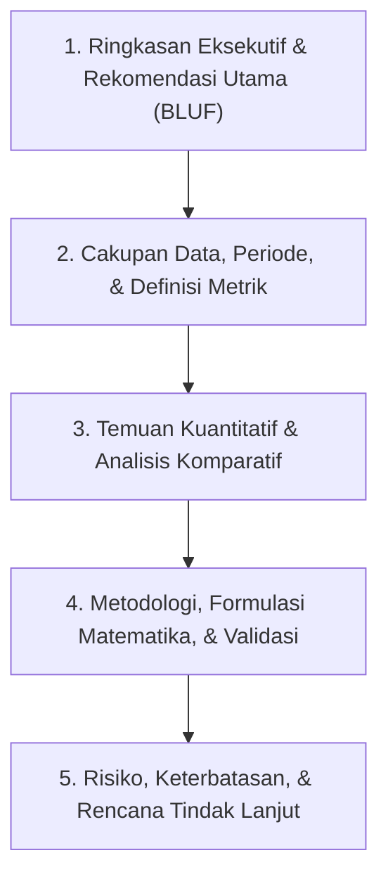

# Professional Report Writer & Executive Document Generator

Standar penyusunan laporan teknis, ilmiah, finansial, dan eksekutif yang rapi, berwibawa, serta siap dipublikasikan dalam format Markdown maupun **Single-File Print-Ready HTML / PDF**.

Skill ini memperbaiki kelemahan pada repositori referensi (`alirezarezvani/claude-skills` `md-document` dan `1donatien0/data-analysis-skill`):
1. **Tanpa Batas Minimum Baris:** `md-document` menolak dokumen di bawah 100 baris; skill ini menerima dokumen dengan panjang berapa pun.
2. **Mendukung Tiga Sumber Input Sekaligus:** Dapat merender laporan dari berkas **Markdown (`.md`)**, **JSON Profil Dataset (`profile-dataset.py`)**, maupun **JSON Manifest Model ML (`train-evaluate-baseline.py`)**.
3. **Dukungan Penuh Matematika (KaTeX & GitHub ```` ```math ````):** Merender blok rumus matematika dan tabel angka presisi (`tabular-nums`).
4. **Siap Cetak ke PDF Ukuran A4 (`@media print`):** Menyertakan aturan pemenggalan halaman (`break-inside: avoid`), kop metadata dokumen, dan tipografi Swiss/Editorial bebas emoji.

---

## 1. Perangkat Generator Laporan (`scripts/build-html-report.py`)

```powershell
# 1. Konversi laporan Markdown (.md) menjadi dokumen HTML eksekutif siap cetak PDF
python skills/professional-report-writer/scripts/build-html-report.py `
  --input docs/laporan-analisis.md `
  --title "Laporan Evaluasi Kinerja Reksa Dana Indonesia" `
  --subtitle "Analisis Kuantitatif Multi-Faktor Periode 2020-2024" `
  --author "Tim Riset Kuantitatif" `
  --output reports/laporan-reksadana.html

# 2. Bangun laporan otomatis dari JSON hasil profile-dataset.py
python skills/professional-report-writer/scripts/build-html-report.py `
  --input scratch/profile_result.json `
  --title "Laporan Audit Kualitas & Eksplorasi Dataset" `
  --output reports/audit-dataset.html

# 3. Bangun laporan evaluasi model otomatis dari model_manifest.json
python skills/professional-report-writer/scripts/build-html-report.py `
  --input models/baseline_run/model_manifest.json `
  --title "Laporan Validasi & Kesiapan Produksi Model ML" `
  --output reports/evaluasi-model.html
```

---

## 2. Arsitektur Laporan: Piramida Minto (BLUF — *Bottom Line Up Front*)

Pembaca eksekutif dan pengambil keputusan membutuhkan kesimpulan pada 30 detik pertama. Setiap laporan profesional **wajib** disusun dari kesimpulan menuju rincian metodologis:



### 2.1 Bagian 1: Ringkasan Eksekutif (*Executive Summary*)
- Maksimal 1 paragraf pengantar dan 3–5 butir temuan utama.
- Setiap butir diawali dengan **subjek tercetak tebal**, diikuti **angka terukur**, **perbandingan**, dan **keputusan yang direkomendasikan**.
- *Contoh:* **Rekomendasi Utama:** Alokasikan bobot 60% pada instrumen Pasar Uang berlikuiditas tinggi ($\text{AUM} \ge \text{Rp } 50\text{ miliar}$), yang menghasilkan rata-rata *Sharpe Ratio* `1,84` dengan *Maximum Drawdown* di bawah `0,45%` sepanjang periode 2020–2024.

### 2.2 Bagian 2: Metadata Cakupan & Kualitas Data
Wajib disajikan dalam tabel ringkas di awal laporan:
- Sumber data dan institusi acuan.
- **Rentang periode waktu observasi** (tanggal awal s.d. tanggal akhir).
- Jumlah observasi total vs jumlah observasi bersih yang dianalisis.
- Asumsi dasar (misal: suku bunga bebas risiko BI Rate $6,0\%$, hari bursa 252 hari/tahun).

### 2.3 Bagian 3: Tabel & Grafik Berstandar Publikasi
1. **Aturan Tabel Angka:**
   - Kolom teks rata kiri (`text-align: left`); kolom angka, persentase, dan mata uang **wajib rata kanan (`text-align: right`)** dengan `font-variant-numeric: tabular-nums`.
   - Tulis satuan di kepala kolom (`AUM (Rp Miliar)`, `Imbal Hasil 1Y (%)`), jangan mengulang kata `Rp` atau `%` di setiap sel jika mengurangi keterbacaan.
   - Gunakan jumlah angka di belakang koma yang konsisten di seluruh kolom (misal: 2 desimal untuk persentase `12,40%`, 4 desimal untuk nilai-$p$ atau skor normalisasi `0,7842`).
2. **Aturan Penulisan Rumus Matematika:**
   - Gunakan blok ```` ```math ```` untuk persamaan utama dan definisikan setiap simbol variabel tepat di bawah rumus dalam bentuk daftar.

### 2.4 Bagian 4: Keterbatasan & Mitigasi Risiko
Laporan yang kredibel selalu menyebutkan batasan analisis secara jujur (misal: risiko *survivorship bias*, keterbatasan data historis terhadap perubahan rezim suku bunga, atau segmen dengan ukuran sampel kecil $n < 30$).

---

## 3. Standar Bahasa & Kerapian Dokumen (Rule 20)

- **Nol Emoji:** Dilarang menaruh emoji di sampul, judul bab, tabel, maupun catatan kaki.
- **Bahasa Baku (KBBI / PUEBI):** Gunakan kata baku (*analisis, risiko, autentikasi, standardisasi, persentase, hipotesis, praktik, mengubah*).
- **Judul Bab Informatif:** Gunakan judul bernomor yang rapi (`1. Ringkasan Eksekutif`, `2. Metodologi dan Formulasi`, `3. Evaluasi Empiris`).
