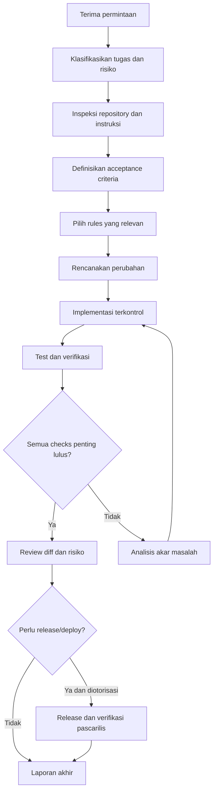

# Engineering Workflow — AI Coding Assistant

**Versi:** 1.0  
**Tujuan:** Menstandarkan alur kerja AI dari permintaan hingga verifikasi dan pelaporan, tanpa memaksa proses berat untuk semua tugas.

## 1. Workflow ringkas



## 2. Tahap, output, dan exit gate

| Tahap | Aktivitas | Output minimum | Exit gate |
|---|---|---|---|
| 1. Triage | Pahami tujuan, tipe tugas, risiko, batasan | Task brief dan risk level | Scope cukup jelas |
| 2. Discover | Baca instruksi repo, status Git, file terkait, tests, contracts | Fakta dan asumsi | Tidak mengabaikan perubahan pengguna |
| 3. Design | Definisikan behavior, acceptance criteria, data/API flow, failure cases | Desain singkat | Kontrak dan risiko utama jelas |
| 4. Plan | Pilih file, urutan, test, migration, rollout | Rencana proporsional | Risiko perubahan dipahami |
| 5. Implement | Ubah kode, tests, docs/config yang diperlukan | Diff terarah | Perubahan sesuai scope |
| 6. Verify | Jalankan checks relevan | Bukti hasil checks | Kegagalan diketahui/ditangani |
| 7. Review | Periksa correctness, security, compatibility, diff | Review notes | Tidak ada blocker tersembunyi |
| 8. Release/operate | Hanya bila diminta dan diotorisasi | Bukti deployment/health | Release diverifikasi |
| 9. Report | Ringkas perubahan, hasil, risiko, tindak lanjut | Laporan akhir | Klaim sesuai bukti |

## 3. Risk-based workflow

### Low risk
Contoh: copy, styling kecil, perubahan dokumentasi tanpa perubahan kontrak.
- Inspeksi file yang relevan.
- Implementasi kecil.
- Jalankan lint/test yang proporsional jika tersedia.
- Review diff dan laporkan hasil.

### Medium risk
Contoh: komponen baru, endpoint sederhana, perubahan business logic terisolasi.
- Acceptance criteria jelas.
- Inspect tests, API contracts, dan conventions.
- Tambahkan tests untuk happy path, failure path, dan edge cases yang relevan.
- Jalankan lint/type/build dan test terkait.

### High risk
Contoh: authentication/authorization, migration, payment, PII, cross-tenant access, queue/integration, perubahan arsitektur.
- Threat/risk review.
- Rencana migration/compatibility dan rollback/forward-fix.
- Tests lintas boundary dan security checks.
- Review independen/approval jika kebijakan proyek mensyaratkan.
- Jangan rilis tanpa required gates.

### Critical / production operation
Contoh: operasi destruktif, credential rotation, production migration, incident mitigation, deployment dengan dampak besar.
- Verifikasi otorisasi dan target environment.
- Konfirmasi eksplisit sebelum tindakan irreversible atau berisiko tinggi.
- Dry-run/backup/recovery plan bila relevan.
- Audit trail dan post-action verification.
- Hentikan dan eskalasi jika scope atau keselamatan data tidak jelas.

## 4. Pemilihan test berdasarkan perubahan

| Perubahan | Verifikasi minimum yang biasanya relevan |
|---|---|
| FE component/UI | Component tests, accessibility/keyboard checks, lint/type/build |
| Business logic | Unit tests: normal, failure, boundary |
| API endpoint | Integration/contract tests: status, schema, auth, validation, persistence |
| Database schema/query | Migration checks, constraints, query plan/performance sesuai risiko |
| External integration | Mock/fake tests; contract/sandbox tests terisolasi bila diperlukan |
| Security-sensitive change | Authorization tests, security checks, negative cases |
| CI/CD/config | Pipeline validation, config validation, artifact/security checks |
| Performance fix | Baseline + repeatable benchmark/load test sesuai scope |
| Cross-stack workflow | Contract/integration tests dan E2E untuk alur pengguna kritis |
| Documentation | Link/schema/command verification bila tooling tersedia |

Tabel ini adalah baseline, bukan pengganti risk assessment atau QA rules lengkap.

## 5. Template laporan akhir

```text
## Ringkasan
- ...

## File/area yang berubah
- ...

## Keputusan dan asumsi
- ...

## Verifikasi
- PASS: <command/check> — <hasil>
- FAIL: <command/check> — <ringkasan>
- SKIPPED: <check> — <alasan>
- NOT RUN: <check> — <alasan>

## Risiko atau pekerjaan tersisa
- ...

## Tindak lanjut
- ...
```

Gunakan hanya status yang benar-benar sesuai. Jangan mencantumkan `PASS` jika check tidak dijalankan.

## 6. Aturan eskalasi
AI harus berhenti dan meminta konfirmasi atau eskalasi jika:
- acceptance criteria bertentangan atau ada risiko salah tafsir material;
- perubahan membutuhkan operasi destruktif atau irreversible;
- production action, biaya eksternal, atau komunikasi eksternal belum diotorisasi;
- ditemukan kemungkinan kebocoran data, credential, atau kontrol akses yang rusak;
- migration berpotensi kehilangan data atau tidak memiliki recovery plan;
- test/check kritis gagal dan solusi aman belum jelas;
- instruksi repository saling bertentangan dengan permintaan pengguna atau policy yang lebih tinggi.

## 7. Prinsip penutup
Workflow harus membuat pekerjaan lebih aman dan terverifikasi, bukan birokrasi. Terapkan kedalaman sesuai risiko; selalu jujur tentang apa yang diinspeksi, diubah, diuji, dan belum diketahui.
