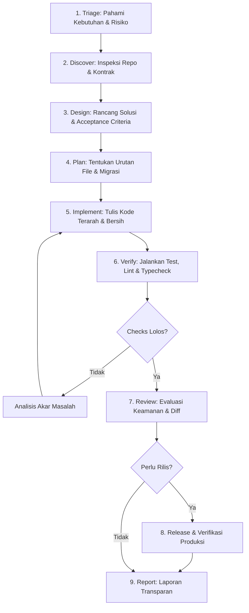

# Engineering Workflows & Master Prompts

Dokumen di dalam folder ini berfungsi sebagai **pemandu orkestrasi utama (*Operating System / Control Plane*)** bagi AI Assistant maupun engineer sebelum atau selama melakukan rekayasa kode.

---

## 1. Daftar Dokumen Workflow

| File | Judul | Fungsi |
|---|---|---|
| [`00-engineering-workflow-ai-coding.md`](./00-engineering-workflow-ai-coding.md) | **AI Coding Assistant Lifecycle & Risk Gates** | Menstandarkan 9 tahapan alur kerja AI: *Triage &rarr; Discover &rarr; Design &rarr; Plan &rarr; Implement &rarr; Verify &rarr; Review &rarr; Release &rarr; Report*. Memiliki diagram Mermaid dan risk matrix. |
| [`01-master-prompt-and-workflow-fullstack.md`](./01-master-prompt-and-workflow-fullstack.md) | **Master Prompt & Full-Stack Orchestrator** | Prompt inti master berbobot ringan (*lean & agile*) untuk diinjeksikan ke AI. Berisi hierarki instruksi, aturan seleksi rules, fase implementasi, dan format pelaporan hasil kerja. |

---

## 2. 9 Tahapan Workflow Rekayasa AI

---

## 3. Tingkat Risiko (Risk-Based Governance)

- **Low Risk (Styling kecil, copy, typo):** Cukup inspeksi lokal, perubahan minimal, lint/format check, dan review diff.
- **Medium Risk (Endpoint baru, business logic terisolasi, komponen interaktif):** Membutuhkan acceptance criteria jelas, unit/integration test skenario happy & unhappy path, serta typecheck.
- **High Risk (Auth, skema migrasi database, payment, PII, perubahan arsitektur):** Wajib threat modeling, rollback/forward-fix plan, pengujian transaksi ketat, audit permission, dan review diff menyeluruh.
